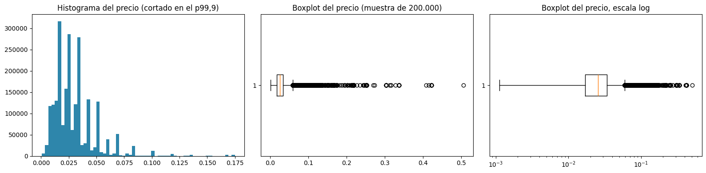
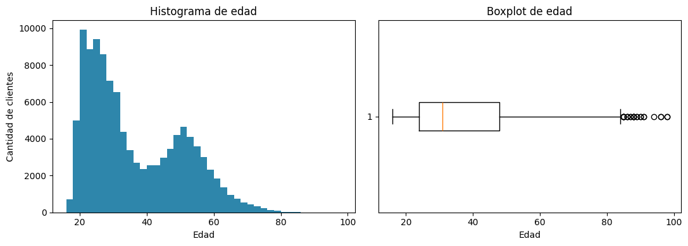
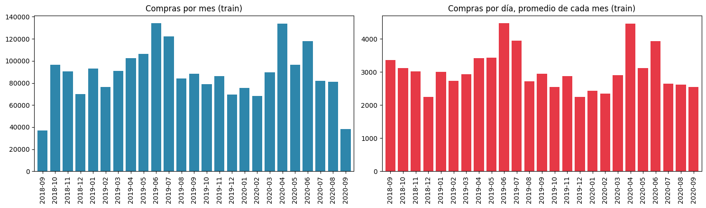
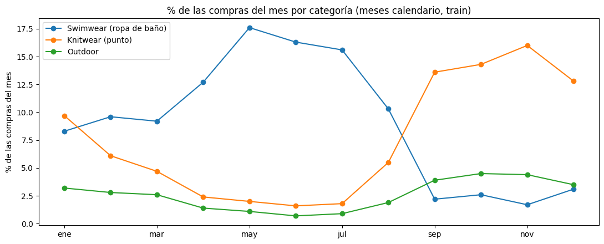
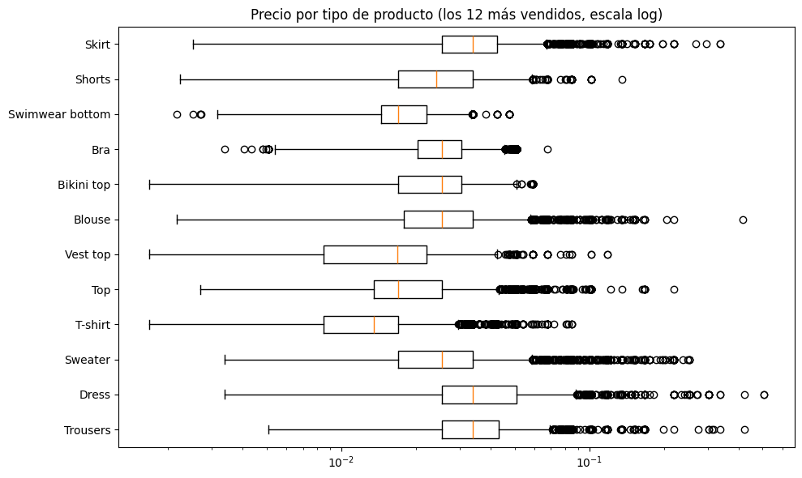
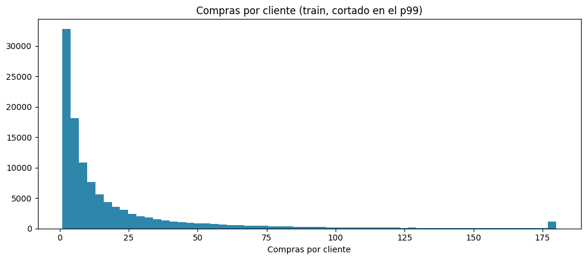
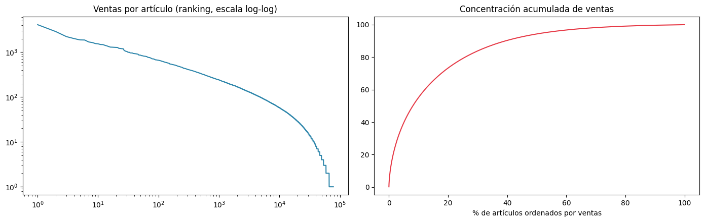
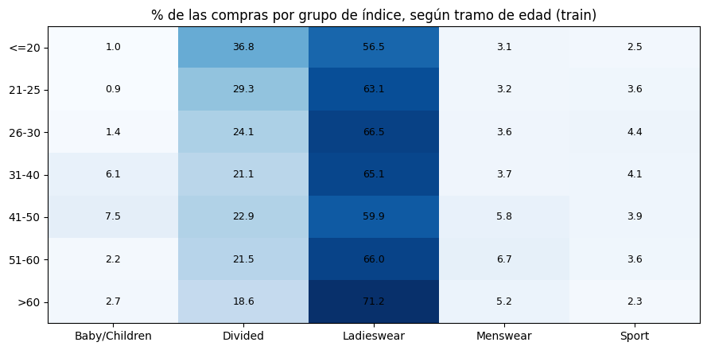

# EDA del dataset H&M (Lookwise Data Lab): recomendador para clientes sin historial (cold start)

**Empresa:** Lookwise Data Lab.

**Metodología:** CRISP-DM con Scrum (sprints).

## Índice

- [Contexto y objetivo](#contexto-y-objetivo)
- [Datos](#datos)
- [Archivos del EDA](#archivos-del-eda)
- [Índice del notebook](#índice-del-notebook)
- [Librerías utilizadas](#librerías-utilizadas)
- [Estado](#estado)
- [Resumen: principales hallazgos del EDA](#resumen-principales-hallazgos-del-eda)
- [Decisiones sobre los datos](#decisiones-sobre-los-datos)
- [Parte 1. Calidad de datos](#parte-1-calidad-de-datos)
  - [Diccionario de variables](#diccionario-de-variables)
  - [Hallazgos en `trans`](#hallazgos-en-trans)
  - [Hallazgos en `cust`](#hallazgos-en-cust-variable-por-variable)
  - [Hallazgos en `art`](#hallazgos-en-art)
  - [Integridad entre tablas](#integridad-entre-tablas)
  - [Lo que aporta la documentación del dataset](#lo-que-aporta-la-documentación-del-dataset)
- [Parte 2. Con el train](#parte-2-con-el-train)
  - [8. Evolución temporal](#8-evolución-temporal)
  - [9. Estacionalidad y hemisferio](#9-estacionalidad-y-hemisferio)
  - [10. Precio por tipo de producto](#10-precio-por-tipo-de-producto)
  - [11. Duplicados por grupo de producto](#11-duplicados-por-grupo-de-producto)
  - [12. Compras por cliente](#12-compras-por-cliente)
  - [13. Artículos y cola larga](#13-artículos-y-cola-larga)
  - [14. Edad y mix de compra](#14-edad-y-mix-de-compra)
  - [15. Clientes fríos y cobertura de artículos](#15-clientes-fríos-y-cobertura-de-artículos)
- [Decisiones tomadas (del grupo)](#decisiones-tomadas-del-grupo)
- [Limitaciones a declarar](#limitaciones-a-declarar)

## Contexto y objetivo

H&M, multinacional sueca de moda, prevé abrir su primera tienda en Argentina en 2027. Como escenario del caso, planteamos que la apertura vaya acompañada del lanzamiento de su tienda online. Sin clientes ni compras locales, el sitio no puede personalizar la experiencia de sus primeros visitantes (*cold start*). Diseñamos un sistema de recomendación para ese lanzamiento.

- **Módulo 1 (principal):** ranking de 12 productos para clientes nuevos o con poco historial, evaluado frente a un baseline de popularidad. La métrica de decisión es Recall@12, medida sobre los clientes reales de la semana de test y sobre clientes simulados como "fríos" (ver `docs/modelado.md`). La propuesta inicial preveía evaluar con MAP@12, Precision@12 y Recall@12 solo sobre clientes simulados. En la etapa de modelado se adoptó Recall@12 porque se vincula de forma más directa con la conversión: mide cuántas de las compras reales habrían estado entre las 12 recomendadas. La elección del modelo no cambia con el criterio.
- **Módulo 2 (posible extensión):** productos complementarios ("Completá el look").

## Datos

Dataset H&M Personalized Fashion Recommendations. **No se incluye en este repositorio**: ver `docs/dataset.md` para obtenerlo y para reproducir la muestra del 10% (p10) que usamos.

La muestra p10 tiene tres tablas, que en el notebook se llaman `trans`, `cust` y `art`:

| Tabla | Qué contiene | Filas | Columnas |
|---|---|---|---|
| `trans` (transacciones) | Una fila por cada artículo comprado por un cliente en una fecha | 2.226.486 | 5 |
| `cust` (clientes) | Una fila por cliente | 110.252 | 7 |
| `art` (artículos) | Una fila por artículo del catálogo | 105.542 | 25 |

Cada fila de `trans` es una transacción. En este documento se las llama "compras", pero la tabla incluye también las compras que después se devolvieron y no informa talle ni cantidad. El detalle de cada variable está en el [Diccionario de variables](#diccionario-de-variables).

## Archivos del EDA

Estos son los archivos del análisis exploratorio. La estructura completa del repositorio está en el [`README.md`](../README.md) de la raíz.

| Archivo | Qué contiene |
|---|---|
| `notebooks/01_muestreo_p10.ipynb` | Cómo se armó la muestra y sus controles |
| `notebooks/02_EDA_unificado_p10.ipynb` | EDA final, unificado y con salidas |
| `notebooks/02_EDA_individual_p10.ipynb` | Pre-exploración individual |
| `docs/eda.md` | Este documento: resumen, diccionario, hallazgos y decisiones |
| `docs/controles_integridad.md` | Muestreo, controles de calidad, decisiones sobre los datos, método para simular clientes fríos y paquete de datos para el modelado |
| `docs/dataset.md` | Cómo obtener los datos y la muestra |
| `reports/figures/eda_01` a `eda_08` (.png) | Gráficos de este documento, exportados del notebook |

## Índice del notebook

Notebook: [`notebooks/02_EDA_unificado_p10.ipynb`](../notebooks/02_EDA_unificado_p10.ipynb). Este documento resume cada sección; el paso a paso y el código están en el notebook.

**Inicio**

| Sección | Contenido |
|---|---|
| Contexto de negocio y objetivo | Planteo del caso y objetivo del EDA |
| 1. Librerías y carga | Carga de las tres tablas de la muestra |
| 2. Diccionario de variables | Qué significa cada columna y de dónde sale la definición |

**Parte 1. Calidad de datos (tablas completas de la muestra)**

| Sección | Contenido |
|---|---|
| 3. Transacciones (`trans`) | Estructura, nulos y tipos · Canal de venta · Fechas · Precio · Duplicados |
| 4. Clientes (`cust`) | Estructura y nulos · `FN` · `Active` · `club_member_status` · `fashion_news_frequency` · `age` · `postal_code` |
| 5. Artículos (`art`) | Estructura y nulos · Clave e identificadores · Valores "Unknown" · Consistencia código / nombre · Descripción y categorías |
| 6. Integridad entre tablas | Cruce entre las tres tablas y artículos sin ventas |
| 7. Corte train/test | Partición por fecha |

**Parte 2. Exploración con train**

| Sección | Contenido |
|---|---|
| 8. Evolución temporal | Actividad por mes y por día de la semana |
| 9. Estacionalidad y hemisferio | Peso de algunas categorías según el mes |
| 10. Precio por tipo de producto | A qué productos corresponde la cola alta del precio |
| 11. Duplicados por grupo de producto | En qué grupos se concentran las filas repetidas |
| 12. Compras por cliente | Cuántas compras tiene cada cliente |
| 13. Artículos y cola larga | Concentración de las ventas |
| 14. Edad y mix de compra | Qué compra cada tramo de edad |
| 15. Clientes fríos y cobertura de artículos | Clientes sin historial y artículos del test que no están en train |

**Cierre:** Hallazgos, decisiones y limitaciones.

## Librerías utilizadas

| Librería | Para qué se usa en el EDA |
|---|---|
| `pandas` | Carga y análisis de las tablas |
| `numpy` | Cálculos numéricos |
| `matplotlib` | Gráficos |
| `pyarrow` | Lectura de los archivos Parquet de la muestra (la usa `pandas`) |

Las versiones están en el [`requirements.txt`](../requirements.txt) de la raíz del repositorio. Para instalarlas: `pip install -r requirements.txt`.

**Principios de trabajo del notebook:** todas las cifras se calculan en las celdas, ninguna se escribe a mano. La calidad de los datos se revisa con las tablas completas de la muestra; lo que sirve para decidir algo (estacionalidad, popularidad, perfil de clientes) se calcula solo con el train, para evitar *data leakage*.

## Estado

Sprint 1: análisis exploratorio terminado sobre la muestra p10. Corte train/test por fecha: entrenamiento hasta el 15/9/2020 y test del 16 al 22/9/2020 (siete días, la última semana del dataset). En el modelado, ese entrenamiento se divide a su vez en train hasta el 8/9 y validación del 9 al 15/9, para tomar las decisiones sin mirar el test (ver `docs/modelado.md`).

## Resumen: principales hallazgos del EDA

- **Muestra p10:** 110.252 clientes, 2.226.486 compras y 105.542 artículos, del 20/9/2018 al 22/9/2020, sin días sin compras. Integridad completa entre tablas.
- **Duplicados:** el 11,96% de las compras son filas repetidas; no se puede confirmar si son varias unidades, distintos talles o devoluciones.
  **Por qué no se eliminan los duplicados.** No se puede confirmar si son errores: la tabla no tiene talle ni cantidad e incluye compras devueltas, así que una fila repetida puede ser una segunda unidad, otro talle o una compra más su devolución. Hay además 17.647 filas repetidas que solo difieren en el precio. Borrarlas perdería información posiblemente real y no se puede deshacer. Por eso se conservan las filas originales, y la versión sin repetidos queda disponible en el paquete de modelado. En el modelado se compararon las dos: los 12 artículos más vendidos coinciden en 11 de 12, así que conservarlas casi no cambia la recomendación (notebook 04).
- **Edad:** 1,10% de vacíos; la distribución tiene dos grupos (alrededor de los 20 a 30 y de los 50 años). Los clientes sin edad compran menos (mediana de 3 compras contra 8).
  Por qué no se imputa en la tabla original: son pocos (1,10%) y en el test solo 7 clientes no tienen edad (ninguno es frío), así que la decisión casi no cambia la evaluación; que falte la edad es informativo (esos clientes compran menos) y rellenar en silencio taparía esa señal; y cómo imputar depende del algoritmo, por eso se ofrecen las tres columnas y cada modelo elige.
- **Estacionalidad:** las ventas siguen un patrón del hemisferio norte (ropa de baño entre mayo y julio, punto entre septiembre y noviembre), invertido respecto de Argentina.
- **Cola larga:** los 12 artículos más vendidos suman 1,1% de las ventas y hacen falta 6.290 artículos para cubrir la mitad.
- **Clientes fríos:** solo 437 clientes del test (10,5%) no tienen compras previas; hace falta simular más fríos ocultando historial.

## Decisiones sobre los datos

**No usamos el código postal.** La propuesta contemplaba simular un mercado nuevo apartando clientes por código postal, pero con estos datos no conviene:

1. Es un hash anonimizado: no tiene significado geográfico ni permite agrupar zonas.
2. Hay 87.652 códigos distintos para 110.252 clientes y el 82% de los códigos tiene un solo cliente.
3. Un único código concentra 2.857 clientes (2,6%), unas 136 veces más que el siguiente (21 clientes), y parece un valor por defecto para datos faltantes. Esos clientes se comportan distinto al resto (por ejemplo, 7,6% sin edad contra 0,9%).

Apartar clientes por código postal daría grupos arbitrarios, que no representarían un mercado nuevo. Los clientes fríos se simulan ocultando historial (ver "Decisiones tomadas").

**Tampoco usamos `FN` y `Active`** (66% de vacíos y el vacío de `Active` no se puede interpretar), y no recomendamos usar `club_member_status` ni `fashion_news_frequency`: la tabla de clientes es una foto de un solo momento y puede reflejar información posterior a las compras (*data leakage*).

Documento de trabajo del análisis exploratorio. Los controles de las muestras (método, tamaño, representatividad) se resumen en `docs/dataset.md`. Base de trabajo: muestra del 10% (`p10`), solo canal online. Las tres tablas se llaman `trans`, `cust` y `art` en el notebook, y todas las cifras de este documento salen de `notebooks/02_EDA_unificado_p10.ipynb`.

## Parte 1. Calidad de datos

Se hace con las tablas completas de la muestra (no depende del corte train/test). Lo que depende de fechas o artículos (parte 2) se hace solo con el train.

### Estado por tabla

| Tabla | Estado |
|---|---|
| `trans` (transacciones) | Cerrada |
| `cust` (clientes) | Cerrada (incluye el cruce de `postal_code` con edad, `FN` y `PRE-CREATE`) |
| `art` (artículos) | Cerrada |
| Parte 2 (train) | Hecha en el notebook unificado; conclusiones abajo |

## Diccionario de variables

Para una versión resumida, con solo el significado de cada variable, ver el [glosario de variables](glosario_variables.md).

Fuente de las definiciones marcadas como "Documentación": documentación disponible del dataset (comentarios del proveedor de los datos; fuente de segunda mano; ver `docs/dataset.md`, sección "Fuentes y referencias"). El resto se interpreta por el nombre de la columna y debe verificarse contra la documentación oficial del dataset.

### `trans` (transacciones): una fila por compra de un artículo. 2.226.486 filas en p10

| Variable | Qué es | Tipo | Notas |
|---|---|---|---|
| `t_dat` | Fecha de la compra | fecha (viene como texto, se convierte) | Sin hora. Del 20/9/2018 al 22/9/2020. 734 días, ninguno sin compras |
| `customer_id` | Identificador anónimo del cliente (hash de 64 caracteres) | texto | Se une con `cust`. No se convierte a número |
| `article_id` | Identificador del artículo (10 dígitos) | texto | Se une con `art`. Conserva ceros iniciales. No incluye talle |
| `price` | Precio pagado, escalado | decimal | Sin unidad: no revelan los valores reales (documentación del dataset). Mediana 0,0254, máximo 0,5068 |
| `sales_channel_id` | Canal de venta: 1 = tienda, 2 = online | entero | Documentación del dataset y verificado con los datos (abril 2020). En p10 vale siempre 2: se excluye del análisis |

### `cust` (clientes): una fila por cliente. 110.252 filas en p10

| Variable | Qué es | Tipo | Notas |
|---|---|---|---|
| `customer_id` | Identificador del cliente | texto | Clave. Sin repetidos |
| `FN` | Si el cliente recibe el newsletter de moda (documentación) | decimal (1.0 o vacío) | 66,2% de vacíos. El vacío equivale casi siempre a "no recibe" (inferencia de los datos) |
| `Active` | Si el cliente está activo para comunicaciones (documentación) | decimal (1.0 o vacío) | 67,0% de vacíos. El vacío no significa "inactivo" y no se puede interpretar |
| `club_member_status` | Estado como socio del club (ACTIVE, PRE-CREATE, LEFT CLUB) | texto | 0,5% de vacíos. PRE-CREATE sin definición en la documentación |
| `fashion_news_frequency` | Frecuencia del newsletter (NONE, Regularly, Monthly) | texto | 1,1% de vacíos |
| `age` | Edad del cliente | decimal | 1,1% de vacíos. 16 a 98 años |
| `postal_code` | Código postal anonimizado (hash) | texto | Sin vacíos. No se interpreta como ubicación |

### `art` (artículos): una fila por artículo. 105.542 filas, 25 columnas

Las definiciones de esta tabla se interpretan por el nombre de cada columna. Donde hay un par código / nombre, el tipo se indica en ese orden.

| Variable | Qué es | Tipo | Notas |
|---|---|---|---|
| `article_id` | Identificador del artículo (un producto en un color) | texto | Clave. Sin repetidos, siempre 10 caracteres. Conserva ceros iniciales. Se une con `trans` |
| `product_code` | Código del producto; agrupa las variantes de color | texto | Son los primeros 7 dígitos del `article_id`. 47.224 productos (2,2 artículos por producto) |
| `prod_name` | Nombre del producto | texto | 517 nombres con espacios dobles; no se corrige |
| `product_type_no` / `product_type_name` | Tipo de producto (por ejemplo, Trousers, Dress) | entero / texto | 132 códigos y 131 nombres. 121 artículos "Unknown" (0,11%) |
| `product_group_name` | Grupo amplio de producto (por ejemplo, Accessories, Shoes) | texto | 19 grupos. 121 artículos "Unknown" (0,11%). Incluye grupos chicos que no son ropa |
| `graphical_appearance_no` / `graphical_appearance_name` | Aspecto de la prenda (liso, rayas, estampado...) | entero / texto | 30 valores |
| `colour_group_code` / `colour_group_name` | Grupo de color | texto / texto | 50 valores. El código conserva ceros iniciales; '-1' = "Unknown" (28 artículos, 0,03%) |
| `perceived_colour_value_id` / `perceived_colour_value_name` | Qué tan claro u oscuro se percibe el color | entero / texto | 8 valores |
| `perceived_colour_master_id` / `perceived_colour_master_name` | Color principal percibido | entero / texto | 20 valores |
| `department_no` / `department_name` | Departamento | entero / texto | 299 códigos para 250 nombres: para agrupar se usa el código |
| `index_code` / `index_name` | Índice (línea de producto) | texto / texto | 10 valores. El código son letras |
| `index_group_no` / `index_group_name` | Grupo de índice | entero / texto | 5 valores. Ladieswear es el 37,6% del catálogo |
| `section_no` / `section_name` | Sección | entero / texto | 57 códigos y 56 nombres |
| `garment_group_no` / `garment_group_name` | Grupo de prenda | entero / texto | 21 valores. 3.873 artículos "Unknown" (3,67%) |
| `detail_desc` | Descripción del artículo en texto libre | texto | 416 vacíos (0,39%). Promedio de 142 caracteres |

Los pares código y nombre (`_no` y `_name`) son consistentes: ningún código tiene más de un nombre. Al revés pasa en `department_name` (22 nombres con más de un código), `product_type_name` y `section_name` (1 cada uno): para agrupar conviene usar el código.

## Hallazgos en `trans`

Cada fila es la compra de un artículo por un cliente en una fecha. Se revisan estructura y nulos, canal de venta, fechas, precio y duplicados.

- **Nulos:** ninguno en las 5 columnas.
- **Tipos:** fecha convertida a fecha; ids como texto (largo constante: 64 y 10 caracteres).
- **Canal:** un único valor (2), se excluye del análisis.
- **Fecha:** 734 días continuos, sin huecos. Sin hora. Día récord: 11/4/2020 (16.104 compras).
- **Precio:** cola larga y gradual a la derecha. Cuantiles: mediana 0,0254; p90 0,0508; p99 0,1017; p99,9 0,1749; máximo 0,5068. Sin precios cero o negativos. No se elimina nada: la cola alta corresponde a abrigos y camperas (ver Parte 2).
- **Duplicados:** 266.398 filas completamente repetidas (11,96%) y 284.045 ignorando el precio. La diferencia (17.647) son casos con precio distinto. Posibles causas: varias unidades, distintos talles o compra más devolución. No se puede confirmar.
  **Por qué no se eliminan los duplicados.** No se puede confirmar si son errores: la tabla no tiene talle ni cantidad e incluye compras devueltas, así que una fila repetida puede ser una segunda unidad, otro talle o una compra más su devolución. Hay además 17.647 filas repetidas que solo difieren en el precio. Borrarlas perdería información posiblemente real y no se puede deshacer. Por eso se conservan las filas originales, y la versión sin repetidos queda disponible en el paquete de modelado. En el modelado se compararon las dos: los 12 artículos más vendidos coinciden en 11 de 12, así que conservarlas casi no cambia la recomendación (notebook 04).

**Distribución del precio**

*Histograma del precio (cortado en el p99,9) y boxplots en escala lineal y logarítmica. La cola derecha es larga pero gradual, sin saltos bruscos. El precio está escalado: no representa dinero real y solo sirve para comparar.*

| Cuantil | 1% | 5% | 25% | 50% (mediana) | 75% | 90% | 99% | 99,9% | Máximo |
|---|---|---|---|---|---|---|---|---|---|
| Precio | 0,0051 | 0,0085 | 0,0169 | 0,0254 | 0,0339 | 0,0508 | 0,1017 | 0,1749 | 0,5068 |

**Filas repetidas**

| Criterio | Filas | % de `trans` |
|---|---|---|
| Completamente repetidas (mismas 5 columnas) | 266.398 | 11,96% |
| Repetidas ignorando el precio (mismo día, cliente y artículo) | 284.045 | 12,76% |
| Diferencia: mismo día, cliente y artículo, con precio distinto | 17.647 | 0,79% |

## Hallazgos en `cust` (variable por variable)

Una fila por cliente. Cada variable se analiza con el mismo esquema: qué es, valores y vacíos, consistencia con otras variables, utilidad para el proyecto y decisión (conservar, usar o descartar). La tabla es una foto de un solo momento.

- **`FN`:** 66,24% de vacíos (73.027). El 99,8% de los `FN = 1` es `Regularly` y el 98,1% de los vacíos es `NONE`: el vacío equivale casi siempre a "no recibe". Redundante con `fashion_news_frequency`: se conserva pero no se usa.
- **`Active`:** 66,98% de vacíos (73.845). El 98,4% de los `Active = 1` es socio ACTIVE, pero el 87,4% de los vacíos también. El vacío no significa "inactivo" y no equivale a `club_member_status`. Se conserva, no se usa.
- **`club_member_status`:** ACTIVE 100.381 (91,0%), PRE-CREATE 9.217 (8,4%), LEFT CLUB 53 (0,05%), vacío 601 (0,55%). PRE-CREATE (sin definición en la documentación): 94,1% tiene `Active` vacío y pesa 6,0% entre los fríos naturales del test contra 1,4% entre los que tienen historial. **No parecen cuentas nuevas**: su primera compra tiene mediana en marzo de 2019 (ACTIVE: abril de 2019), pero compran menos (mediana de 4 compras contra 8). Qué significa sigue abierto. Riesgo de leakage (foto de un solo momento).
- **`fashion_news_frequency`:** NONE 71.709 (65,0%), Regularly 37.293 (33,8%), Monthly 46 (0,04%), vacío 1.204 (1,09%, todos con `FN` vacío). Se conserva, sin uso.
- **`age`:** 1.208 vacíos (1,10%); 16 a 98 años, mediana 31, promedio 35,9. Histograma con dos grupos (20 a 30 y alrededor de 50). 27 clientes superan los 84 años (7 los 90): plausible, no se eliminan. Los clientes sin edad compran menos (mediana 3 contra 8 compras): el vacío no parece aleatorio. Decisión: grupo "sin edad" aparte, sin imputar con la mediana.
- **`postal_code`:** 87.652 valores distintos, 82% con un solo cliente. Un código concentra 2.857 clientes (136 veces el segundo): parece un valor por defecto. Ese grupo tiene más edad vacía (7,6% contra 0,9%) y casi no tiene PRE-CREATE (0,7% contra 8,6%). Se conserva, no se usa como variable. La propuesta prevé simular un mercado nuevo apartando clientes por código postal, pero con estos datos no conviene: el hash no tiene significado geográfico, el 82% de los códigos tiene un solo cliente y el código dominante parece "sin dato", así que solo se podrían apartar grupos arbitrarios. La justificación completa va en el README.

**Vacíos por variable**

| Variable | Vacíos | % |
|---|---|---|
| `Active` | 73.845 | 66,98% |
| `FN` | 73.027 | 66,24% |
| `age` | 1.208 | 1,10% |
| `fashion_news_frequency` | 1.204 | 1,09% |
| `club_member_status` | 601 | 0,55% |
| `customer_id`, `postal_code` | 0 | 0% |

**Distribución de la edad**

*El histograma muestra dos grupos: uno grande entre los 20 y 30 años y otro más chico alrededor de los 50. El boxplot, al resumir todo en una caja, no deja ver esa forma. Por eso no se imputa con la mediana general (31 años): mezclaría dos grupos con comportamiento distinto.*

## Hallazgos en `art`

Una fila por artículo. Se revisan nulos, la clave y los identificadores, los valores "Unknown" que funcionan como faltantes, la consistencia entre códigos y nombres y la calidad de las descripciones y categorías.

- **Nulos:** solo `detail_desc` (416, 0,39%), sobre todo en prendas de arriba y calzado.
- **Clave:** `article_id` sin repetidos, siempre 10 caracteres. `product_code` = primeros 7 dígitos; 47.224 productos para 105.542 artículos (2,2 variantes por producto).
- **"Unknown" escondidos:** `garment_group_name` 3.873 (3,67%), `product_group_name` y `product_type_name` 121 (0,11%), `colour_group_name` 28 (0,03%, código -1). Se tratan como una categoría más.
- **Descripción:** promedio 142 caracteres; 61.722 repetidas (las variantes comparten texto).
- **Categorías:** bien escritas. Grupos chicos que no son ropa (Cosmetic, Bags, Items, Furniture). `index_group_name` lo domina Ladieswear (37,6% del catálogo).
- **Sin ventas:** 27.224 (25,8%) en la muestra completa; 27.762 (26,3%) en train. Inflado por la muestra del 10%.

**Faltantes escondidos como "Unknown"**

| Variable | Artículos | % del catálogo |
|---|---|---|
| `garment_group_name` | 3.873 | 3,67% |
| `product_group_name` | 121 | 0,11% |
| `product_type_name` | 121 | 0,11% |
| `colour_group_name` (código -1) | 28 | 0,03% |

## Integridad entre tablas

Se verifica que todos los clientes y artículos de las compras existan en sus tablas maestras (integridad referencial) y cuántos artículos del catálogo no tienen ventas.

Todos los clientes y artículos de `trans` existen en sus tablas; todos los clientes de `cust` compraron al menos una vez.

El 25,8% del catálogo (27.224 artículos) no tiene ventas en la muestra. Como la muestra es el 10% de los clientes, ese porcentaje está inflado respecto del dataset completo. Cualquier cifra por artículo se ve afectada por esto; las cifras por cliente no, porque de cada cliente elegido se conserva todo su historial.

## Lo que aporta la documentación del dataset

- El esquema de evaluación original del dataset usa los 7 días posteriores al fin de los datos, la misma semana para todos los clientes: respalda nuestra regla de test de 7 días.
- Se permite recomendar artículos que el cliente ya compró.
- La tabla de transacciones incluye todas las compras, aunque se hayan devuelto después.
- No se revela de qué mercado vienen los datos (proveedor de los datos): limitación para la estacionalidad.
- Abril 2020 sin ventas de tienda; propuesta de otros análisis del dataset: tratar como atípico.

## Parte 2. Con el train

Corte adoptado por el grupo: train hasta el 15/9/2020, test del 16 al 22/9/2020 (7 días completos). Otro EDA individual del grupo llegó al mismo corte de forma independiente. Train: 2.210.154 compras (99,3%) y 109.815 clientes. Test: 16.332 compras y 4.162 clientes.

La partición es temporal, nunca al azar: el test son los últimos 7 días completos del dataset. Desde acá se trabaja solo con el train, para que ninguna decisión use información del futuro. La excepción son los duplicados (sección 11), que se identifican en la tabla completa porque son un control de calidad.

| Conjunto | Fechas | Compras | % | Clientes |
|---|---|---|---|---|
| Train | 20/9/2018 al 15/9/2020 | 2.210.154 | 99,3% | 109.815 |
| Test | 16/9/2020 al 22/9/2020 | 16.332 | 0,7% | 4.162 |

Los últimos 14 días quedan entre 0,74 y 1,31 veces el nivel de las 4 semanas previas, sin ningún día extremo, así que la semana de test es comparable con el resto.

### 8. Evolución temporal

Se describe la actividad por mes y por día de la semana para detectar estacionalidad, meses atípicos y períodos incompletos.

*Izquierda: compras por mes. Derecha: compras por día (promedio de cada mes), que corrige los meses con menos días de datos.*

| Día | Lunes | Martes | Miércoles | Jueves | Viernes | Sábado | Domingo |
|---|---|---|---|---|---|---|---|
| % de las compras | 13,9 | 13,9 | 16,1 | 14,9 | 13,5 | 13,5 | 14,1 |

**Conclusión:** septiembre de 2018 (11 días) y septiembre de 2020 (15 días en train) están incompletos en días, **no en ritmo** (3.355 y 2.552 compras por día, dentro de lo normal). Los picos de ritmo diario son junio de 2019 (4.480 por día) y abril de 2020 (4.459 por día); diciembre es el mes más bajo (unas 2.250 por día). Abril de 2020 coincide con el cierre de tiendas de la pandemia (otros análisis del dataset lo señalan como atípico; es una hipótesis, el dataset no lo dice), y se lo evaluó junto con marzo y mayo de 2020; **decisión del grupo: se conservan en el entrenamiento** (ver `reports/tratamiento_datos.csv`). Por día de la semana el miércoles es el más alto (16,1%) y viernes y sábado los más bajos (13,5%); el resto queda entre 13,9% y 14,9%.

### 9. Estacionalidad y hemisferio

Se mira cómo cambia durante el año el peso de algunas categorías para inferir el hemisferio de los datos, ya que el proveedor de los datos no revela el mercado.

*Peso de cada categoría sobre el total de compras de cada mes calendario (train).*

| Mes | Ropa de baño (`Swimwear`) | Punto (`Knitwear`) | `Outdoor` |
|---|---|---|---|
| Enero | 8,3% | 9,7% | 3,2% |
| Febrero | 9,6% | 6,1% | 2,8% |
| Marzo | 9,2% | 4,7% | 2,6% |
| Abril | 12,7% | 2,4% | 1,4% |
| Mayo | 17,6% | 2,0% | 1,1% |
| Junio | 16,3% | 1,6% | 0,7% |
| Julio | 15,6% | 1,8% | 0,9% |
| Agosto | 10,3% | 5,5% | 1,9% |
| Septiembre | 2,2% | 13,6% | 3,9% |
| Octubre | 2,6% | 14,3% | 4,5% |
| Noviembre | 1,7% | 16,0% | 4,4% |
| Diciembre | 3,1% | 12,8% | 3,5% |

**Conclusión:** la ropa de baño pesa 17,6% de las compras en mayo, 16,3% en junio y 15,6% en julio, contra 1,7% en noviembre y 2,2% en septiembre; el punto (`Knitwear`) va al revés: 16,0% en noviembre, 14,3% en octubre y 13,6% en septiembre, contra 1,6% en junio y 2,0% en mayo. Es el patrón del **hemisferio norte**, invertido respecto de Argentina. Esto sale de los datos (el proveedor de los datos no revela el mercado): indica el hemisferio, **no el país**. Se mira como proporción del total del mes para que las liquidaciones o los picos de ventas no distorsionen. Para usar el recomendador en Argentina, la estacionalidad debería invertirse o ignorarse (limitación).

### 10. Precio por tipo de producto

Se busca a qué tipos de producto corresponde la cola alta del precio y si el precio depende del tipo. Es el pendiente que había quedado para el cruce de `trans` con `art`.

*Precio de los 12 tipos de producto más vendidos, en escala logarítmica.*

| Tipo de producto | Compras en el 0,1% más caro (2.230 en total) |
|---|---|
| Coat (abrigo) | 527 |
| Jacket (campera) | 505 |
| Dress (vestido) | 465 |
| Sweater (suéter) | 277 |
| Trousers (pantalón) | 114 |

| Tipo de producto | Mediana del precio |
|---|---|
| Coat (abrigo) | 0,0949 |
| Jacket (campera) | 0,0678 |
| Boots (botas) | 0,0542 |
| T-shirt (remera) | 0,0135 |
| Socks (medias) | 0,0135 |

**Conclusión:** la cola alta del precio no son errores: el 0,1% más caro (2.230 compras) son sobre todo abrigos (527) y camperas (505), vestidos (465) y suéteres (277). La mediana por tipo lo confirma: Coat 0,0949, Jacket 0,0678 y Boots 0,0542, contra 0,0135 de T-shirt y Socks. **El precio depende del tipo de producto**, por lo que no se compara entre tipos distintos ni se eliminan los valores altos.

### 11. Duplicados por grupo de producto

Se mira en qué grupos de producto se concentran las filas repetidas de `trans` (sección 3.5) para acotar las explicaciones posibles.

| Grupo de producto | Compras | % de filas repetidas |
|---|---|---|
| Prendas de arriba (`Garment Upper body`) | 840.088 | 10,6% |
| Prendas de abajo (`Garment Lower body`) | 522.087 | 13,9% |
| Prendas de cuerpo entero (`Garment Full body`) | 282.518 | 11,8% |
| Ropa de baño (`Swimwear`) | 215.874 | 16,8% |
| Ropa interior (`Underwear`) | 167.379 | 11,4% |
| Accesorios (`Accessories`) | 78.431 | 5,6% |
| Calzado (`Shoes`) | 62.496 | 8,4% |
| Ropa de dormir (`Nightwear`) | 25.508 | 9,1% |
| Medias y pantys (`Socks & Tights`) | 24.097 | 14,7% |

**Conclusión:** los duplicados aparecen en **todos** los grupos: ropa de baño 16,8%, medias y pantys 14,7%, prendas de abajo 13,9%, prendas de cuerpo entero 11,8%, de arriba 10,6%, calzado 8,4% y accesorios 5,6%. Son más bajos en los accesorios (que no tienen talle), pero no son cero, así que **no alcanza para decidir** entre "varias unidades", "distintos talles" o "compra y devolución" y puede ser una mezcla. **Decisión del grupo:** se conservan, porque no hay evidencia de error y representan más demanda (ver `reports/tratamiento_datos.csv`).

### 12. Compras por cliente

Se describe cuántas compras tiene cada cliente en train. Es la base para decidir cómo simular clientes fríos (con poco historial).

*Compras por cliente en el train, con el eje cortado en el p99 (180 compras).*

| Medida | Mínimo | p10 | p25 | Mediana | Promedio | p75 | p90 | p99 | Máximo |
|---|---|---|---|---|---|---|---|---|---|
| Compras por cliente | 1 | 1 | 3 | 7 | 20,1 | 21 | 51 | 180 | 1.068 |

**Conclusión:** en train hay 109.815 clientes con compras (los otros 437 solo compran en el test). Mediana de 7 compras, promedio 20,1, p90 51, p99 180 y máximo 1.068. El 11,3% tiene una sola compra y el 41,8% tiene 5 o menos: **hay muchos clientes con muy poco historial**, lo que favorece simular clientes fríos ocultando parte del historial.

### 13. Artículos y cola larga

Se mide la concentración de las ventas y cuántos artículos casi no se venden. Es la referencia para el baseline de popularidad.

*Izquierda: ventas por artículo, ordenados de mayor a menor (escala log-log). Derecha: porcentaje acumulado de las ventas según el porcentaje de artículos.*

| Artículos más vendidos | % acumulado de las ventas |
|---|---|
| 12 | 1,1% |
| 100 | 4,6% |
| 1.000 | 18,9% |
| 5.000 | 44,8% |
| 6.290 | 50% |

De los 105.542 artículos del catálogo, 77.780 tienen ventas en el train y 27.762 (26,3%) no.

**Conclusión:** la cola es muy larga: los 12 artículos más vendidos suman solo 1,1% de las ventas, los 1.000 primeros 18,9% y hacen falta 6.290 artículos para cubrir la mitad. 11.591 artículos (14,9% de los vendidos) se vendieron una sola vez, y 27.762 (26,3% del catálogo) no tienen ventas en train, aunque en la muestra del 10% esos números están inflados (sección 6). Un recomendador de "lo más vendido" tiene mucho margen de mejora y va a necesitar **atributos del artículo**, no solo su historial.

### 14. Edad y mix de compra

Se cruza la edad del cliente con el grupo de índice de lo que compra, para ver si la edad es una señal útil cuando no hay historial.

*Cada fila suma 100%: es el reparto de las compras de ese tramo de edad entre los grupos de índice (train).*

**Conclusión:** el mix de compra cambia con la edad. Divided (línea joven) pesa 36,8% entre los de 20 años o menos y baja a 18,6% después de los 60; Ladieswear sube de 56,5% a 71,2%; Menswear sube de 3,1% a 6,7% (entre los 51 y 60 años); y Baby/Children se concentra entre los 31 y 50 años (6,1% y 7,5%), seguramente compras para hijos. La edad es una **señal útil para clientes fríos** con perfil conocido (hipótesis a probar en el modelo). Ladieswear domina en todos los tramos.

### 15. Clientes fríos y cobertura de artículos

Se cuantifica cuántos clientes del test son fríos naturales (sin compras en train) y qué proporción de los artículos del test no aparece en train. Estas cifras condicionan cómo se evalúa el recomendador.

| Clientes del test | Cantidad | % |
|---|---|---|
| Total que compran en el test | 4.162 | 100% |
| Con historial en el train | 3.725 | 89,5% |
| Fríos naturales (sin compras en el train) | 437 | 10,5% |

| Artículos del test | Cantidad | % |
|---|---|---|
| Artículos distintos comprados en el test | 4.778 | 100% |
| Ausentes en el train | 538 | 11,3% |

**Conclusión:** en el test compran 4.162 clientes y solo **437 son fríos naturales** (10,5%; 1.442 compras, 8,8% del test). Son pocos para evaluar un modelo, lo que justifica **sumar fríos simulados** (ocultar parte del historial de clientes con compras). Se parecen en edad (mediana 29 contra 31), pero son más seguido socios PRE-CREATE (6,0% contra 1,4%), pero como detector de clientes fríos es débil: de los 77 clientes PRE-CREATE del test solo 26 son fríos (33,8%, contra 10,5% en general) y esos 26 cubren apenas el 5,9% de los fríos (ver la advertencia de *leakage* de la sección 4.4). Además, 538 de los 4.778 artículos del test (11,3%; 9,4% de las compras) no aparecen en train, y los 12 más vendidos de train solo cubren el 0,92% de las compras del test: un baseline de "lo más vendido" parte **débil**, y se necesitan atributos del artículo para los artículos nuevos. Las cifras por cliente son confiables; las por artículo están afectadas por el muestreo del 10%.

## Decisiones tomadas (del grupo)

El detalle de cada tratamiento está en `reports/tratamiento_datos.csv`.

- **Corte temporal:** train hasta el 15/9/2020 y test del 16 al 22/9/2020 (7 días).
- **Marzo a mayo de 2020:** se conservan en el entrenamiento.
- **Duplicados:** se conservan (misma prenda, cliente y día).
- **Edad vacía:** no se imputa; forman el grupo "sin edad".
- **`PRE-CREATE` y el resto de las variables de cliente:** no se usan; solo se usa la edad.
- **Clientes fríos:** se simulan ocultando el historial (0, 1 o 2 compras visibles). Los resultados están en `docs/modelado.md`.

## Limitaciones a declarar

- Canal 2 = online según la documentación del dataset (indirecta) y confirmado con los datos.
- Mercado desconocido; el hemisferio norte se infiere de la estacionalidad.
- Precio sin unidad.
- Sin talle ni cantidad; la tabla incluye devoluciones.
- Fecha sin hora.
- `customers` es una foto de un solo momento, sin fecha de registro de cada valor. No se sabe si `Active`, `FN`, `club_member_status` o `age` reflejan al cliente cuando compró por primera vez o su situación posterior; usarlas podría filtrar información del futuro (leakage), un riesgo relevante para los clientes en frío.
- Evaluación offline: los datos solo registran compras, no qué artículos vio cada cliente (sesgo de exposición). La evaluación (Recall@12 sobre la semana de test) mide si se acierta lo que efectivamente se compró. El top 12 del baseline parte de ese sesgo. Fuente: análisis público sobre el dataset (hilo "Recommender systems - Evaluation hell").
- La muestra es el 10% de los clientes: las cifras por artículo (artículos sin ventas, artículos del test ausentes en train) están infladas; las cifras por cliente no, porque se conserva todo el historial de cada cliente elegido.
- No se trabaja con imágenes.
