# Lookwise Data Lab · Modelado del sistema de recomendación

Sistema de recomendación para **clientes nuevos de H&M** en e-commerce: qué 12 prendas mostrarle a cada cliente para que encuentre algo que quiera comprar.

**Autor:** Lookwise Data Lab · Integrantes y roles en la sección [Equipo](../README.md#equipo) del README

> **Notebook final:** `notebooks/06_metricas_optimizacion_decisiones.ipynb`. De ahí salen el modelo elegido y los resultados de este documento. Los notebooks 03 a 05 son las etapas previas del modelado.

## Índice

- [Archivos del modelado](#archivos-del-modelado)
- [Índice de los notebooks](#índice-de-los-notebooks)
- [Librerías utilizadas](#librerías-utilizadas)
- [1. Resultado en una línea](#1-resultado-en-una-línea)
- [2. Qué hicimos](#2-qué-hicimos)
  - [Datos](#datos)
  - [Cómo evaluamos](#cómo-evaluamos)
  - [Modelos (`src/modelos.py`)](#modelos-srcmodelospy)
- [3. Qué encontramos](#3-qué-encontramos)
  - [Resultados del test (16–22/09/2020)](#resultados-del-test-1622092020)
  - [Hipótesis](#hipótesis)
  - [Simulación de clientes nuevos (`notebooks/05_simulacion_cold_start.ipynb`)](#simulación-de-clientes-nuevos-notebooks05_simulacion_cold_startipynb)
  - [Lo más importante, en simple](#lo-más-importante-en-simple)
- [4. Qué pasó en el camino (decisiones y ajustes)](#4-qué-pasó-en-el-camino-decisiones-y-ajustes)
- [5. Recomendaciones para H&M](#5-recomendaciones-para-hm)
  - [Próximos pasos del proyecto](#próximos-pasos-del-proyecto)
- [6. Detalle de los notebooks](#6-detalle-de-los-notebooks)
  - [6.1 Notebook 03 · Baseline y personalización por edad (M1)](#61-notebook-03--baseline-y-personalización-por-edad-m1)
  - [6.2 Notebook 04 · Tratamiento, features, co-compra (M2) y ranker (M3)](#62-notebook-04--tratamiento-features-co-compra-m2-y-ranker-m3)
  - [6.3 Notebook 05 · Simulación de clientes nuevos](#63-notebook-05--simulación-de-clientes-nuevos)
  - [6.4 Notebook 06 · Métricas, optimización, selección y evaluación final](#64-notebook-06--métricas-optimización-selección-y-evaluación-final)


## Archivos del modelado

Estos son los archivos del modelado. La estructura completa del repositorio está en el [`README.md`](../README.md) de la raíz.

> **El notebook 06 es el final.** Contiene las métricas, la optimización, la selección del modelo y la evaluación en test, y de ahí salen los resultados de este documento. Los notebooks 03 a 05 son las etapas previas: compararon los modelos con MAP@12 y el ranker que quedaba elegido en el 04 era la regresión logística, por lo que sus cifras pueden diferir de las finales.

| Archivo | Qué contiene |
|---|---|
| `notebooks/03_baseline.ipynb` | Etapa previa: baseline (lo más vendido) y Modelo 1 por edad; diseño de la evaluación |
| `notebooks/04_pipeline_modelos.ipynb` | Etapa previa: tratamiento de datos cuantificado, features, Modelo 2 (co-compra) y Modelo 3 (ranker); primera comparación de modelos |
| `notebooks/05_simulacion_cold_start.ipynb` | Simulación de clientes nuevos: desde cuántas compras conviene personalizar |
| `notebooks/06_metricas_optimizacion_decisiones.ipynb` | **Final:** métricas, baseline optimizado, hiperparámetros, selección del modelo, evaluación final en test, variables y ejemplos |
| `src/datos.py` | Carga, verificación y tratamiento de los datos |
| `src/features.py` | Pipeline de features sin fuga de información |
| `src/metricas.py` | Métricas de recomendación e intervalo de confianza |
| `src/modelos.py` | Baseline, M1, M2, M3 y modelo final |
| `src/optimizacion.py` | Métricas de clasificación, baseline optimizado y búsqueda de hiperparámetros |
| `src/simulacion.py` | Reglas y funciones de la simulación de clientes nuevos |
| `src/pipeline.py` | Ejecución de punta a punta: reproduce sin notebooks el modelo final del notebook 06, sus resultados y los artefactos de `models/` |
| `models/` | Modelo final (`ranker_clasificador.joblib`), su configuración (`configuracion_modelo.json`) y las recomendaciones de la semana de test |
| `reports/*.csv` | Resultados de cada etapa (insumo del dashboard en Power BI) |
| `reports/figures/modelado_*.png` | Gráficos de este documento (sección 6), exportados de los notebooks |
| `docs/modelado.md` | Este documento |

Para reproducir los resultados finales:

```
pip install -r requirements.txt
```

dejar la muestra p10 en `dataset/p10/`, abrir el notebook 06 desde la carpeta `notebooks/` y ejecutar **Run All** (los notebooks leen los datos desde `../dataset/p10`, no hace falta editar rutas). Los datos no se suben al repositorio: están en el Drive del equipo.

---

## Índice de los notebooks

Los notebooks se leen en orden: 03, 04, 05 y 06. Los tres primeros son las **etapas previas** (se compararon con MAP@12 y su ranker era la regresión logística); **el notebook 06 es el final**: de él salen el modelo elegido y los resultados de este documento. Cada notebook tiene su paso a paso y su código.

**Notebook 03 · Baseline y personalización por edad (M1)** · [`notebooks/03_baseline.ipynb`](../notebooks/03_baseline.ipynb)

| Sección | Contenido |
|---|---|
| 1. Preparación y verificación de los datos | Carga de las tres tablas y controles automáticos |
| 2. Diseño de la evaluación | Corte temporal (train, validación y test) · Clientes fríos · KPIs y métricas |
| 3. Baseline | Lo más vendido, histórico y reciente: ventana elegida en validación y resultado en test |
| 4. Modelo 1 · Popularidad por tramo de edad (H1) | Mapa de calor · Clientes por tramo · Ventana · Resultado en test · Intervalo de confianza · Ejemplos · Trade-offs |
| 5. Resumen de resultados y exportación | Tabla final y CSV para el dashboard |
| 6. Conclusiones, recomendaciones y próximos pasos | Cierre del notebook |

**Notebook 04 · Tratamiento, features, co-compra (M2) y ranker (M3)** · [`notebooks/04_pipeline_modelos.ipynb`](../notebooks/04_pipeline_modelos.ipynb)

| Sección | Contenido |
|---|---|
| 1. Tratamiento de datos (cuantificado) | Decisiones del EDA aplicadas con `src/datos.py` y su impacto en filas · Duplicados: conservar o colapsar |
| 2. Pipeline de ingeniería de características | Tablas de features a una fecha de corte (`src/features.py`) |
| 3. Modelo 2 · Co-compra + recompra (no supervisado) | Configuraciones probadas en la semana de validación |
| 4. Modelo 3 · Ranker supervisado | Entrenamiento y validación · Qué aprendió · Comparación de algoritmos (regresión logística, HistGradientBoosting, XGBoost y LightGBM) |
| 5. Comparación final de los cuatro modelos en el test | Tablero de métricas · Incremento frente al baseline · Duelo entre modelos · Intervalos de confianza · Verificación de hipótesis |
| 6. ¿Qué modelo ganó y por qué? | Tabla completa, gráfico del ganador y explicación con los números |
| 7. Justificación del modelo elegido | Elección por segmento en validación · Sistema final · Exportación de resultados |
| 8. Resumen ejecutivo | Los números principales en lenguaje de negocio |
| 9. Conclusiones, recomendaciones y próximos pasos | Veredicto final y conclusiones |

**Notebook 05 · Simulación de clientes nuevos** · [`notebooks/05_simulacion_cold_start.ipynb`](../notebooks/05_simulacion_cold_start.ipynb)

| Sección | Contenido |
|---|---|
| 1. Datos y clientes de la simulación | Reglas de selección de clientes y control anti-fuga |
| 2. Escenario principal | Compras visibles más recientes (0, 1, 2 y historial completo) · Gráfico e intervalos de confianza |
| 3. Control de sensibilidad | Qué pasa si las compras visibles son las primeras de la vida del cliente |
| 4. Simulados y reales | El escenario de 0 compras frente a los clientes nuevos reales |
| 5. Conclusión | Cuándo dejar de mostrar lo más vendido |
| 6. Exportar resultados | Tablas en `reports/` para el dashboard |

**Notebook 06 · Métricas, optimización, selección y evaluación final (final)** · [`notebooks/06_metricas_optimizacion_decisiones.ipynb`](../notebooks/06_metricas_optimizacion_decisiones.ipynb)

| Sección | Contenido |
|---|---|
| 1. Datos y protocolo de validación | Entrenamiento hasta el 08/09, validación 09–15/09, test 16–22/09 |
| 2. Métricas de evaluación | Recall@12 como métrica de decisión · Métricas por lista y por par cliente–prenda |
| 3. Baseline optimizado | Nueve variantes de popularidad evaluadas en 4 semanas |
| 4. Ranker con regresión logística (modelo base) | Candidatas, entrenamiento y por qué la Accuracy no alcanza |
| 5. Optimización de hiperparámetros | 16 configuraciones de regresión logística y Gradient Boosting |
| 6. Selección entre regresión logística y Gradient Boosting | Intervalo de confianza de la diferencia y regla de decisión |
| 7. Co-compra + recompra (no supervisado) | Ventanas de 14 y 28 días, con y sin recompra · Comparación en validación |
| 8. Evaluación final en test | Modelo final por etapas frente a la referencia, por segmento |
| 9. Importancia de las variables | Importancia por permutación |
| 10. Ejemplos de recomendaciones | Dos clientes con historial y un cliente nuevo |
| 11. Justificación del modelo elegido | Decisiones del proceso y alternativas descartadas |
| 12. Limitaciones, conclusiones y próximos pasos | Cierre |
| 13. Persistencia del modelo y exportación de resultados | Archivos en `models/` y verificación de carga |

---

## Librerías utilizadas

| Librería | Para qué se usa en el modelado |
|---|---|
| `pandas` | Carga, tratamiento y análisis de las tablas |
| `numpy` | Cálculos numéricos y métricas |
| `matplotlib` | Gráficos de los notebooks |
| `scikit-learn` | Regresión logística, HistGradientBoosting, importancia por permutación y métricas de clasificación |
| `xgboost` | Algoritmo candidato para el ranker (notebook 04) |
| `lightgbm` | Algoritmo candidato para el ranker (notebook 04) |
| `joblib` | Guardar y cargar el modelo final en `models/` (se instala con `scikit-learn`) |
| `pyarrow` | Lectura de los archivos Parquet de la muestra (la usa `pandas`) |

Además de estas librerías, los notebooks importan los módulos propios de `src/` (`datos`, `features`, `metricas`, `modelos`, `optimizacion`, `simulacion`). Las versiones están en el [`requirements.txt`](../requirements.txt) de la raíz del repositorio. Para instalarlas: `pip install -r requirements.txt`.

---

## 1. Resultado en una línea

El **modelo final** más que **duplica los aciertos** de lo que se hace hoy (mostrar lo más vendido) en los clientes con historial: **Recall@12 de 7,53% frente a 2,78%** (unas 2,7 veces) y **Hit Rate@12 de 14,8 frente a 7,3 de cada 100**. En los clientes nuevos **es equivalente** a hoy (sin diferencia significativa). Además, la simulación muestra que **desde la primera compra** ya conviene personalizar.

| Tipo de cliente | Recall@12 hoy | Recall@12 modelo final | Hit Rate@12 hoy | Hit Rate@12 modelo final |
|---|---|---|---|---|
| Todos (4.162) | 2,71 | **6,95** | 6,97 | **13,70** |
| Con historial (3.725) | 2,78 | **7,53** | 7,25 | **14,79** |
| Nuevos (437) | 2,07 | **2,04** | 4,58 | **4,35** |

*Recall@12 = % de las prendas compradas que estaban entre las 12 recomendadas. Hit Rate@12 = clientes de cada 100 que compran al menos una de las 12 recomendadas. "Hoy" = popularidad de los últimos 7 días. Semana de test: 16–22/09/2020. En clientes nuevos la diferencia no es significativa (IC 95%: −0,09 a 0,00 puntos).*

---

## 2. Qué hicimos

### Datos
- **Muestra p10:** 2.226.486 compras online, 110.252 clientes y 105.542 artículos. La armó el equipo en `notebooks/01_muestreo_p10.ipynb` (ver `docs/dataset.md`) y se analizó en `notebooks/02_EDA_unificado_p10.ipynb`, con semilla fija y controles de integridad.
- **Tratamiento cuantificado** (`src/datos.py`): 8 decisiones, cada una medida. **No se borró ninguna compra real.**

| Tema | Afecta | Decisión |
|---|---|---|
| Duplicados (misma prenda, cliente y día) | 12,76% | Se conservan: pueden ser varias unidades (más demanda); no se puede confirmar |
| Meses atípicos (mar–may 2020) | 14,38% | Se conservan: el test no cae en ese período |
| Precios fuera de rango (IQR) | 7,49% | Se conservan: son ventas reales |
| Clientes sin edad | 1,10% | No se imputa: forman el grupo "sin edad" |

### Cómo evaluamos
- **Partición temporal:** entrenamiento hasta el 08/09/2020, validación del 09 al 15/09 y test del 16 al 22/09/2020. Simula el uso real: se recomienda con el pasado y se mide con lo que pasa después.
- **Validación:** la semana del 09 al 15/09 se usó para elegir baseline, parámetros y modelo, **sin mirar el test**. Con las decisiones tomadas, se reentrena hasta el 15/09 y se mide en el test **una sola vez**.
- **Sin fuga de información:** todas las variables se calculan solo con compras anteriores a la fecha de corte, y hay un control automático.
- **Métrica de decisión: Recall@12**, con MAP@12 como desempate. Es la que mejor se vincula con la conversión: mide cuántas de las compras reales habrían sido visibles en la vitrina personalizada. En los notebooks 03 a 05 la comparación se hizo con MAP@12; desde el notebook 06 decide Recall@12. **La elección del modelo no cambia con el criterio:** el ranker obtiene el mejor resultado en ambas métricas.
- **Métricas** (`src/metricas.py` y `src/optimizacion.py`):

| Nivel | Métrica | Pregunta |
|---|---|---|
| Lista de 12 | **Recall@12** (decide) | ¿Qué parte de lo que compró el cliente estaba en sus 12 recomendaciones? |
| Lista de 12 | Hit Rate@12 | ¿Qué % de clientes compró algo de la lista? |
| Lista de 12 | Precision@12 | ¿Cuántos de los 12 lugares se aprovecharon? |
| Lista de 12 | MAP@12 | ¿Las prendas compradas aparecen arriba? |
| Lista de 12 | Prendas distintas | ¿A cuántas prendas damos visibilidad? |
| Par cliente–prenda | Accuracy, Balanced accuracy | ¿Cuántas predicciones compra / no compra son correctas? |
| Par cliente–prenda | Recall, Precision, F1 | ¿Detecta compras y a qué costo en falsas alarmas? |
| Par cliente–prenda | ROC-AUC, PR-AUC | ¿Ordena las compras por encima de las no compras, sin depender de un umbral? |

**Por qué la Accuracy no decide:** solo ~0,5% de los pares cliente–prenda terminan en compra. Un modelo que nunca predice compra tiene 99,5% de Accuracy y 0% de Recall.

Cada mejora se verifica con un **intervalo de confianza del 95%** (bootstrap pareado). Si no incluye el 0, la mejora es real.

### Modelos (`src/modelos.py`)

| Modelo | Tipo | Idea |
|---|---|---|
| Baseline | Referencia | Lo más vendido de los últimos 7 días (lo que se hace hoy) |
| Baseline optimizado | Referencia exigente | Lo más vendido con decaimiento temporal (vida media de 3 días), elegido entre 9 variantes y 4 semanas |
| M1 · Edad | Personalización simple | Lo más vendido en el tramo de edad del cliente |
| M2 · Co-compra | No supervisado | "Quienes compraron esto también compraron…" + recompra (ventana de 28 días) |
| M3 · Ranker | Supervisado | Aprende a ordenar ~40 prendas candidatas combinando todas las señales |
| **Modelo final** | Sistema por etapas | Ranker (Gradient Boosting) si el cliente ya compró; baseline optimizado si es nuevo |

Para el ranker se partió de la **regresión logística como modelo base** (simple e interpretable) y se optimizaron los hiperparámetros de dos algoritmos (16 configuraciones). La diferencia se resolvió con una regla fijada antes de ver el resultado: se elige Gradient Boosting solo si el intervalo de confianza de la mejora no incluye el 0.

| Algoritmo (mejor configuración) | Recall@12 (validación) |
|---|---|
| Regresión logística (C=10, clases balanceadas) | 6,52% |
| **Gradient Boosting (elegido)** | **6,92%** |

Diferencia: **+0,40 puntos** de Recall@12, IC 95% **[+0,11; +0,68]** → no incluye el 0, la mejora es significativa.

---

## 3. Qué encontramos

### Resultados del test (16–22/09/2020)

**Recall@12 (%)** — métrica de decisión

| Modelo | Todos | Con historial | Nuevos |
|---|---|---|---|
| Popularidad 7 días (referencia actual) | 2,71 | 2,78 | 2,07 |
| Baseline optimizado | 2,62 | 2,68 | 2,04 |
| M2 · Co-compra + recompra | 6,04 | 6,50 | 2,04 |
| M3 · Ranker (Gradient Boosting) | 6,96 | 7,53 | 2,11 |
| **Modelo final (por etapas)** | **6,95** | **7,53** | **2,04** |

**Hit Rate@12 (%) y MAP@12**

| Modelo | Hit Rate (todos) | Hit Rate (con historial) | Hit Rate (nuevos) | MAP@12 (todos) | Prendas distintas |
|---|---|---|---|---|---|
| Popularidad 7 días (referencia actual) | 6,97 | 7,25 | 4,58 | 0,0083 | 12 |
| Baseline optimizado | 6,61 | 6,87 | 4,35 | 0,0064 | 12 |
| M2 · Co-compra + recompra | 10,93 | 11,70 | 4,35 | 0,0310 | 10.246 |
| M3 · Ranker (Gradient Boosting) | 13,77 | 14,79 | 5,03 | 0,0363 | 4.123 |
| **Modelo final (por etapas)** | **13,70** | **14,79** | **4,35** | **0,0361** | **4.123** |

**Mejora del modelo final frente a la referencia actual (Recall@12, IC 95% bootstrap):** con historial **+4,75 puntos** (IC +3,89 a +5,48, mejora significativa); nuevos **−0,03 puntos** (IC −0,09 a 0,00, sin diferencia significativa).

### Hipótesis

**Cómo leer el resultado** (criterio fijado antes de ver el test):

- **Se cumple:** el modelo mejora MAP@12 y Hit Rate@12, y el intervalo del 95% de la mejora no incluye el 0. La mejora es real.
- **Mejora, pero no es concluyente:** el modelo mejora, pero el intervalo incluye el 0. Puede ser azar; hace falta más evidencia.
- **No se cumple:** el modelo no mejora. La hipótesis se descarta.

| # | Hipótesis | Resultado | Qué encontramos | Cómo lo resolvimos |
|---|---|---|---|---|
| H1 | La edad supera a lo más vendido en clientes nuevos | No se cumple | Con los 437 clientes nuevos, la edad acierta a 4,3 de cada 100 y lo más vendido a 4,6. La edad sola no dice qué le gusta a alguien | Para clientes nuevos usamos **lo más vendido de la semana**. Proponemos sumar datos de contexto (categoría que mira, canal, temporada) |
| H2 | El historial (co-compra) supera a la edad | Se cumple | La co-compra acierta a 11,7 de cada 100 clientes con historial; la edad, a 5,6. MAP@12 +515% | El historial pasa a ser la base de la personalización: **"quienes compraron esto también compraron…"** |
| H3 | El supervisado supera al no supervisado | Mejora, no concluyente; sin intervalo propio contra la co-compra | Con historial, el ranker sube el Hit Rate de 11,70 a 14,79 (+26%), el Recall@12 de 6,50 a 7,53 y el MAP@12 de 0,0340 a 0,0396. El intervalo de confianza se calculó contra la referencia actual y entre algoritmos, no entre ranker y co-compra | Lo elegimos porque **ganó en validación** con la regla fijada de antemano y el test mantuvo el mismo orden (ranker > co-compra > popularidad). Se confirma con una prueba A/B |
| H4 | Lo reciente supera a lo histórico | Se cumple | En 4 semanas de validación, la popularidad con decaimiento de 3 días (Recall@12 2,54%) supera a la de 7 días (2,38%), y la de todo el historial rinde menos de la mitad. La simulación lo confirma: con compras viejas, personalizar deja de ganar | **Lo más vendido se recalcula cada semana**, dando más peso a lo reciente, y la vitrina personalizada se actualiza en cada visita |
| H5 | Personalizar reparte la visibilidad del catálogo | Se cumple | Lo más vendido muestra las mismas 12 prendas a todos; el modelo final, 4.123 prendas distintas | La personalización da salida a la **cola larga** del catálogo, que hoy no se ve |

### Simulación de clientes nuevos (`notebooks/05_simulacion_cold_start.ipynb`)

Como hay pocos clientes nuevos reales, a **3.549 clientes con historial** se les ocultó el pasado y se les dejó visibles 0, 1 o 2 compras. Las compras ocultas se borraron de toda la base para evitar fuga de información.

| Compras visibles | Lo más vendido | Mejor modelo | ¿Mejora real? |
|---|---|---|---|
| 0 | 5,9 | Ranker 7,2 | Solo en simulación: con nuevos reales gana lo más vendido |
| **1** | 5,9 | **Ranker 10,6** | Sí |
| 2 | 6,6 | Ranker 12,1 | Sí |
| Historial completo | 7,2 | Ranker 14,0 | Sí |

**Respuesta:** con 0 compras, lo más vendido; **desde la primera compra, el ranker**. Es exactamente el corte que usa el modelo final.

*Valores de Hit Rate@12 (clientes de cada 100). La simulación se hizo con el ranker de regresión logística del notebook 04, antes de la optimización del notebook 06 (que eligió Gradient Boosting).*

### Lo más importante, en simple
1. **El historial es la señal más fuerte.** Lo que más predice una compra: si el cliente ya compró la prenda, el puntaje de co-compra y cuántos días pasaron desde su última compra.
2. **La edad sola no alcanza.** No le gana a lo más vendido en ningún escenario y no agrega señal cuando hay historial.
3. **Gana el Gradient Boosting, por poco.** Supera a la regresión logística en +0,40 puntos de Recall@12 (IC +0,11 a +0,68). La diferencia es chica pero real, y se compensa la pérdida de interpretabilidad con la importancia de variables.
4. **Lo reciente manda.** La popularidad con decaimiento de 3 días es la mejor referencia; la de todo el historial rinde menos de la mitad. En la simulación, con compras viejas personalizar deja de ganarle a lo más vendido.
5. **Personalizar da visibilidad al catálogo.** Hoy se muestran 12 prendas a todos; el modelo final muestra 4.123 distintas.

---

## 4. Qué pasó en el camino (decisiones y ajustes)

| Situación | Qué hicimos | Por qué |
|---|---|---|
| Un clasificador que nunca predice compra tiene 99,5% de Accuracy | Se decide con Recall@12 sobre el ranking, no con métricas a umbral fijo | Con ~0,5% de compras, la Accuracy no discrimina |
| Un baseline débil exagera la mejora de cualquier modelo | Se optimizó el baseline: 9 variantes de popularidad evaluadas en 4 semanas | Comparación más exigente y estable |
| Regresión logística y Gradient Boosting quedaban a pocas décimas | Se definió antes de ver el resultado una regla con bootstrap; el Gradient Boosting la cumplió (+0,40 puntos, IC +0,11 a +0,68) | Sumar complejidad solo si la mejora no es azar |
| Sin historial, el ranker no mejora a lo más vendido (clientes nuevos) | Modelo final por etapas: ranker para quien ya compró, baseline para nuevos | Sin historial las variables del cliente quedan vacías |
| Con 437 clientes nuevos ninguna diferencia era concluyente | Simulación de clientes nuevos con 3.549 clientes (propuesta del equipo) | Más evidencia para fijar cuándo personalizar |
| En la simulación, el ranker ganaba con 0 compras pero no con nuevos reales | Para 0 compras manda la evidencia real; la simulación decide 1 y 2 compras | Los simulados eran compradores frecuentes, no nuevos |
| El ranker armaba recomendaciones de a un cliente (muy lento) | Se arman en bloque | De más de 40 minutos a pocos minutos |

---

## 5. Recomendaciones para H&M

1. **Implementar el modelo final por etapas:** lo más vendido de la semana para quien nunca compró y el ranker desde la primera compra.
2. **Actualizar la vitrina personalizada en cada visita.** Lo reciente es lo que predice.
3. **Recalcular "lo más vendido" cada semana**, dando más peso a lo reciente (decaimiento de 3 días), no con todo el historial.
4. **Mostrar "quienes compraron esto también compraron…"** en la página de producto y en el carrito: la co-compra es la señal más fuerte.
5. **No personalizar solo por edad.** No supera a lo más vendido.
6. **Para clientes que vuelven tras mucho tiempo**, combinar sus compras viejas con lo más vendido.
7. **Aprovechar la cola larga:** pasar de 12 a más de 4.000 prendas visibles ayuda a vender stock que hoy no se ve.
8. **Validar con una prueba A/B** antes de llevarlo a toda la tienda, midiendo conversión (Recall@12 y Hit Rate) y productos por pedido.
9. **Para clientes nuevos, sumar información de contexto** (categoría que mira, canal de llegada, temporada), porque la edad sola no alcanza.
10. **Monitorear las métricas cada semana** y reentrenar si caen.

### Próximos pasos del proyecto
- Ampliar la generación de candidatas (prendas nuevas, similares por atributos): el ranker solo ve ~40 candidatas, que contienen alrededor del 12% de las compras.
- Validar los hiperparámetros con varias semanas.
- Volver a correr la simulación de clientes nuevos con el ranker de Gradient Boosting.
- Demo en Streamlit: elegir un cliente y ver sus 12 recomendaciones.
- Dashboard en Power BI con los CSV de `reports/`.
- Registro de cada corrida en MLflow y automatización con GitHub Actions.
- Análisis de costos y retorno de la inversión (objetivo: recuperarla en 6 meses o menos).
- Modelo de contenido para prendas nuevas, que todavía no tienen ventas.

---

## 6. Detalle de los notebooks

En esta parte están los gráficos más relevantes de cada notebook con su contexto y su interpretación. El paso a paso completo, con todos los gráficos, está en los notebooks. **Cómo leerla:** los notebooks 03 a 05 corresponden a las etapas previas y compararon los modelos con MAP@12; sus textos y cifras pueden diferir de los finales (por ejemplo, el ranker que quedaba elegido en el notebook 04 era la regresión logística). **Los resultados finales y la selección del modelo están en el notebook 06 y en las secciones 1 a 5 de este documento.**

### 6.1 Notebook 03 · Baseline y personalización por edad (M1)

Notebook: [`notebooks/03_baseline.ipynb`](../notebooks/03_baseline.ipynb).

**Lookwise Data Lab** · Sistema de recomendación para clientes nuevos de H&M (e-commerce)
**Autor:** Lookwise Data Lab · **Fase:** Modelado
**Datos:** muestra p10 de H&M (10% de los clientes online, historial completo) · 20/09/2018 – 22/09/2020

**Resumen ejecutivo**

| | Hallazgo | Implicancia para H&M |
|---|---|---|
| 1 | **1 de cada 10 compradores semanales es nuevo** (437 de 4.162 en la semana de test) | Una parte relevante de las ventas depende de clientes de los que no sabemos nada |
| 2 | Mostrando las 12 prendas más vendidas de la semana, **solo ~5 de cada 100 clientes nuevos** encuentran algo que compran | Más del 95% de los clientes nuevos no encuentra nada relevante: conversión perdida |
| 3 | **Actualizar la lista cada semana casi triplica los aciertos** frente a usar los más vendidos históricos (6,97% vs 2,45%) | Mejora inmediata y sin costo: la moda cambia rápido |
| 4 | **Modelo 1 (por edad):** ver el veredicto automático de la sección 4.4 | Personalización desde la primera visita, usando un dato que el cliente informa al registrarse |

**Baseline oficial del equipo:** popularidad de los últimos 7 días → **MAP@12 = 0,0083 · Hit Rate@12 = 6,97% (todos) · 4,58% (fríos)**. Todo modelo del equipo debe superar estos valores.

**Problema de negocio**
Un cliente nuevo no tiene historial, por lo que la tienda no sabe qué mostrarle. Si en su primera visita no encuentra nada que le interese, se va sin comprar: **se pierde la venta y el costo de haberlo atraído**. Este notebook construye la **vara de medición** del proyecto y prueba la primera solución personalizada para ese cliente.

**Del KPI de negocio a la métrica técnica (detalle en la sección 2.3)**
| KPI de negocio (lo que ve la dirección) | Cómo lo aproximamos offline | Métrica técnica |
|---|---|---|
| **KPI principal: conversión de clientes nuevos** | % de clientes nuevos que compró al menos 1 de las 12 prendas recomendadas | **Hit Rate@12 en fríos** |
| **KPI secundario: productos por pedido** | Qué parte de lo que el cliente compró estaba en la recomendación | **Recall@12** |
| **Experiencia / engagement** | ¿Lo que compran aparece arriba en la lista? ¿Cuánto del espacio de la vitrina se aprovecha? | **MAP@12** (métrica principal) y **Precision@12** |
| **Salud del catálogo** | ¿Recomendamos siempre lo mismo o damos visibilidad a más prendas? | **Prendas distintas recomendadas** (diversidad) |

> **¿Por qué no un test A/B?** Un A/B necesita mostrar recomendaciones a clientes reales en la tienda en vivo. Trabajamos con datos históricos y sin acceso a la web de H&M ni a datos de visitas. Por eso evaluamos **offline**, simulando el uso real con un corte temporal. El A/B queda como paso de validación para cuando la empresa implemente el sistema.

**Contenido**
1. Preparación y verificación de los datos
2. Diseño de la evaluación: corte temporal, clientes fríos y métricas
3. Baseline: ¿qué puede hacer H&M hoy sin ciencia de datos?
4. Modelo 1: popularidad por tramo de edad (Hipótesis H1)
5. Resumen de resultados y exportación para el dashboard
6. Conclusiones, recomendaciones y próximos pasos

**Decisiones del equipo que aplica este notebook (tabla de decisiones del EDA)**
| # | Decisión | Cómo se aplica acá |
|---|---|---|
| 1 | Test: 16 al 22/09/2020; train hasta el 15/09 | Sección 2.1 |
| 2 | Marzo a mayo 2020 se conservan en train | No se filtra ningún período |
| 3 | Duplicados: se conservan las filas originales | Una compra repetida cuenta como más demanda de esa prenda |
| 4 | Edad vacía: no se imputa | Grupo propio "sin edad" (sección 4) |
| 5 | Variables de cliente: solo la edad | No se usan FN, Active, postal_code, club_member_status ni fashion_news_frequency |
| 7 | Artículos ausentes en el train | Se reporta un escenario de diagnóstico (sección 3.2) |
| 8 | Segmento nuevo por tramo de edad | Sección 4.2 |
| 9 | Baseline: popularidad histórica y reciente | Sección 3, ventana elegida en validación |

> **Para reproducir:** dejar la muestra en `dataset/p10/` y ejecutar *Run All*. Los datos no se suben al repositorio.

#### 2. Diseño de la evaluación

Antes de construir modelos definimos **cómo los vamos a juzgar**. Esta sección es la base de todo el proyecto: si la evaluación está mal diseñada, cualquier resultado es engañoso.

**2.1 Corte temporal: train, validación y test**

**Qué hacemos:** dividimos los datos por fecha.
- **Train** (hasta el 15/09/2020): el pasado del que aprende el modelo.
- **Validación** (09 al 15/09/2020, dentro del train): un *simulacro* para tomar decisiones (por ejemplo, qué ventana usar) sin tocar el test.
- **Test** (16 al 22/09/2020): el examen final, que el modelo nunca ve.

| Decisión | Por qué sí | Por qué no la alternativa |
|---|---|---|
| **Corte por fecha** | Simula el uso real: se recomienda hoy y se mide qué compran después | **Corte aleatorio:** el modelo vería compras del futuro (*leakage*) y el resultado sería artificialmente alto |
| **Test de 7 días** | Es el horizonte real de una campaña semanal de e-commerce | **30 días:** mezcla tendencias que cambian dentro del mes; además dejaría menos historial reciente para aprender |
| **Última semana del dataset** | Es el período más reciente y "normal" | **Marzo–abril 2020:** son meses atípicos (pandemia); el EDA los conserva en train pero no sirven como test representativo |
| **Validación separada** | Permite elegir parámetros sin mirar el examen | **Elegir mirando el test:** es como ver las respuestas antes del examen |

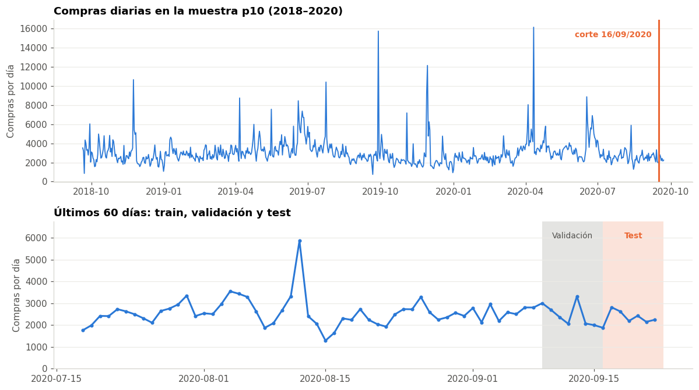

**Interpretación**
- **Train concentra el 99,3% de las compras** (2.210.154) y el **test el 0,7%** (16.332): casi todo el historial queda para aprender y se evalúa en una semana real completa.
- El gráfico muestra que la **semana de test tiene un volumen comparable** a las semanas previas: no es una semana atípica, lo que hace creíble la evaluación.
- Se ven picos fuertes (por ejemplo, abril 2020 y junio 2019, documentados en el EDA): confirma que la demanda **cambia mucho en el tiempo**, una primera pista de que lo reciente importará.

**Implicancia:** la evaluación reproduce el uso real del sistema (recomendar el lunes y medir las compras de la semana), por lo que los resultados son interpretables como **"qué hubiera pasado si H&M usaba esto"**.

#### 2.2 Clientes fríos: el foco del proyecto

**Qué hacemos:** identificamos a los clientes cuya **primera compra** ocurre en la semana de test. Antes del corte no tenían ninguna compra: son **clientes fríos** (*cold start*).

**Ejemplo:** María compró 15 veces en 2019–2020 y vuelve el 18/09 → **no es fría**. Lucía compra por primera vez el 18/09 → **es fría**: el sistema no sabe nada de ella.

| Decisión | Por qué sí | Por qué no la alternativa |
|---|---|---|
| **Frío = primera compra después del corte** | Se mide contra la fecha de corte: es exactamente la situación del cliente nuevo al momento de recomendar | **Usar `club_member_status = PRE-CREATE`:** el EDA mostró que no son cuentas nuevas y detecta solo el 5,9% de los fríos |
| **Reportar fríos por separado** | Es el segmento del problema de negocio; un promedio general lo escondería | **Solo el promedio general:** el 90% de clientes con historial dominaría el resultado |

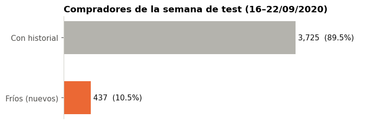

**Interpretación**
- En la semana de test compran **4.162 clientes**, y **437 (10,5%) son fríos**: **1 de cada 10 compradores semanales es nuevo**.
- Cada comprador se lleva **~3,9 prendas** en la semana: hay espacio para aumentar productos por pedido con buenas recomendaciones.
- **El 4.162 y el 437 no se "mejoran":** son datos fijos de la realidad (cuántos clientes rinden el examen). Lo que un modelo mejora son las **métricas** (qué porcentaje encuentra algo).

**Implicancia:** cada semana, 1 de cada 10 compradores llega sin historial. Para ellos, un recomendador tradicional no puede personalizar: es el hueco que este proyecto busca cubrir.

**Implicancia técnica:** con 437 casos, la métrica en fríos tiene **alta variabilidad** (pocos aciertos más o menos mueven el porcentaje). Más adelante se complementará con **fríos simulados** (punto 6 del EDA).

> **¿Por qué no simulamos fríos todavía?** Los modelos de este notebook (popularidad general y por edad) **no usan el historial del cliente**: recomiendan lo mismo a María y a Lucía si tienen la misma edad. Ocultar historial no cambiaría nada. La simulación cobra sentido con los modelos que sí usan historial (co-compra, ranker).

#### 4.4 Evaluación en el test: ¿se cumple H1?

**Criterio de éxito (definido ANTES de ver los resultados):** H1 se cumple si el modelo por edad **supera al baseline oficial en los clientes fríos** en **MAP@12** (métrica principal) y en **Hit Rate@12** (proxy de conversión).

> Escribir el criterio antes de correr el modelo demuestra que la conclusión no se acomodó a los números.

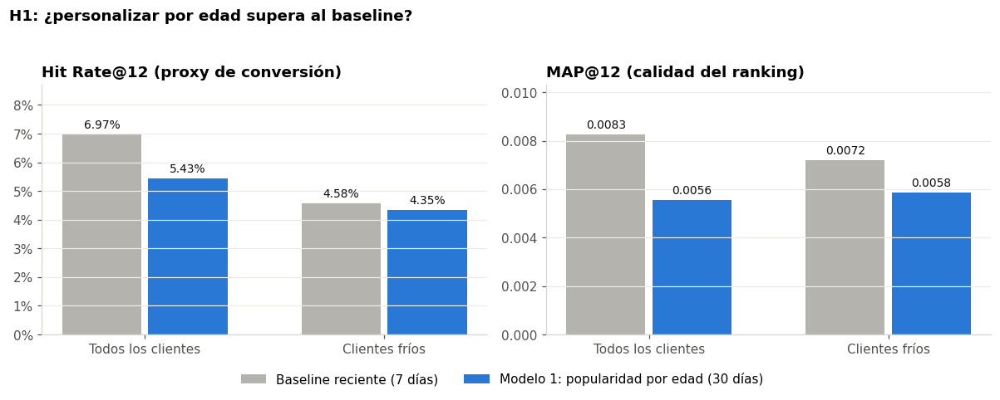

### 6.2 Notebook 04 · Tratamiento, features, co-compra (M2) y ranker (M3)

Notebook: [`notebooks/04_pipeline_modelos.ipynb`](../notebooks/04_pipeline_modelos.ipynb).

**Lookwise Data Lab** · Sistema de recomendación para clientes nuevos de H&M (e-commerce)
**Autor:** Lookwise Data Lab · **Fase:** Preparación de datos y modelado
**Continúa:** `03_baseline.ipynb` (baseline, métricas y Modelo 1 por edad)

**Objetivo**
Llevar el sistema de recomendación desde la **línea base actual** (mostrar lo más vendido) hasta un **sistema personalizado** que funcione tanto para clientes nuevos como para clientes con historial, con cada decisión medida y justificada.

| Pregunta de negocio | Dónde se responde |
|---|---|
| ¿Los datos son confiables para tomar decisiones? | Sección 1 · tratamiento de datos cuantificado (`src/datos.py`) |
| ¿Qué información de clientes y productos usamos para recomendar? | Sección 2 · pipeline de características (`src/features.py`) |
| ¿Cuánto aporta aprovechar el historial de compras? | Sección 3 · Modelo 2, co-compra (no supervisado) |
| ¿Puede un modelo aprender a combinar todas las señales? | Sección 4 · Modelo 3, ranker (supervisado) |
| ¿Cuál es el mejor modelo y cuánto mejora frente a hoy? | Sección 5 · comparación y tablero de resultados |
| **¿Qué modelo ganó y por qué?** | **Sección 6 · ganador por tipo de cliente, con métricas y KPIs** |
| ¿Qué sistema conviene implementar y por qué? | Sección 7 · justificación y alternativas descartadas |
| ¿Qué debería hacer H&M? | Secciones 8 y 9 · resumen ejecutivo, conclusiones y recomendaciones |

**Hipótesis del estudio**
Antes de ver los resultados del test definimos **qué esperamos encontrar** y **cómo lo vamos a verificar**. Así la conclusión no se acomoda a los números. El veredicto automático está en el **Paso 5.7**.

| # | Hipótesis | Por qué la planteamos (evidencia previa) | Cómo se verifica | Si se cumple, H&M puede… |
|---|---|---|---|---|
| **H1** | Personalizar por **edad** mejora la recomendación para **clientes nuevos** frente a "lo más vendido" | El EDA mostró que la edad cambia la mezcla de productos; es el único dato del cliente nuevo | M1 vs Baseline en **fríos** | Personalizar desde la primera visita |
| **H2** | Usar el **historial de compras** (co-compra) supera a personalizar solo por edad en clientes que ya compraron | El 89% de los clientes tiene más de una compra: hay señal que la edad no captura | M2 vs M1 en **con historial** | Ofrecer "Quienes compraron esto también compraron…" |
| **H3** | Un modelo **supervisado** que combina todas las señales supera al **no supervisado** | Cada modelo captura una señal distinta; aprender a combinarlas debería sumar | M3 vs M2 en **con historial** | Justificar la inversión en un modelo más complejo |
| **H4** | Lo **reciente** predice mejor que lo **histórico** (la moda cambia rápido) | El EDA mostró estacionalidad fuerte | Popularidad 7 días vs histórica en **validación** | Actualizar las recomendaciones cada semana |
| **H5** | Personalizar **reparte la visibilidad** del catálogo en más prendas | Recomendar lo más vendido muestra las mismas 12 a todos | Prendas distintas: mejor modelo vs Baseline | Dar salida a la cola larga y reducir quiebres de stock |

**Criterio de verificación (fijado antes de ver el test):** **se cumple** si el modelo mejora MAP@12 y Hit Rate@12 **y** la mejora en MAP@12 es robusta (intervalo de confianza que no incluye el 0) · **mejora pero no es concluyente** si mejora pero el intervalo incluye el 0 · **no se cumple** si no mejora.

**Cómo está organizado el código**
La lógica vive en **scripts** (reutilizables por todo el equipo y por la futura app de Streamlit); este notebook **los usa y explica los resultados**.

| Script | Qué hace | Etapa CRISP-DM |
|---|---|---|
| `src/datos.py` | Carga, verificación y tratamiento de datos (cuantificado) | Entendimiento y preparación |
| `src/features.py` | Pipeline de features **sin leakage** | Preparación |
| `src/metricas.py` | Las 5 métricas del equipo + intervalo de confianza | Evaluación |
| `src/modelos.py` | Baseline, Modelo 1 (edad), Modelo 2 (co-compra, no supervisado) y Modelo 3 (ranker, supervisado), todos con la misma interfaz | Modelado |
| `src/pipeline.py` | Corre todo de punta a punta y reproduce el notebook 06: `python src/pipeline.py --base <carpeta p10> --salida <carpeta> --modelos <carpeta>` | Reproducibilidad |

> **Para reproducir:** dejar la muestra en `dataset/p10/` y ejecutar *Run All*.

> **Importante:** los resultados (tablas, gráficos y la **interpretación automática** de cada paso) aparecen **solo después de ejecutar Run All**. Cada celda de código imprime su propia interpretación con los números reales.

**Cómo leer este notebook**
Cada paso tiene siempre la misma estructura:
1. **Paso X.Y:** qué vamos a hacer y por qué, en simple.
2. **Código:** lo que hace la computadora.
3. **Lectura automática:** la interpretación que escribe el propio código con los resultados.
4. **Interpretación:** qué significa para el proyecto y para H&M.

#### Paso 5.5 · Gráfico comparativo de los 4 modelos

**Qué hace:** muestra la tabla anterior en barras. **Gris = baseline, azul = Modelo 1 (edad), verde = Modelo 2 (co-compra), naranja = Modelo 3 (supervisado).** Izquierda: Hit Rate@12 (proxy de conversión). Derecha: MAP@12 (métrica principal). **Barra más alta = mejor.**

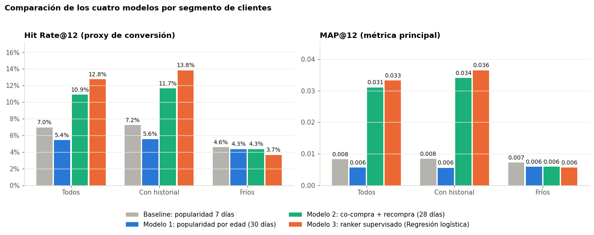

**Hallazgo**
El gráfico resume la comparación: **barra más alta = mejor**. Se ve en qué segmento cada modelo marca la diferencia y dónde los modelos de historial empatan con la edad (clientes fríos).

**Implicancia para el negocio**
Es el gráfico que resume los resultados: muestra en una imagen que la personalización supera a la estrategia actual.

**Paso 5.6 · ¿Las mejoras son reales o pueden ser azar?**
**Qué hace:** para tres comparaciones clave, repite la evaluación 1.000 veces con clientes sorteados (*bootstrap*) y calcula el rango donde cae la diferencia el 95% de las veces (**intervalo de confianza**).
- **Robusta:** el rango no incluye el 0 → la mejora (o empeora) es real.
- **No concluyente:** el rango incluye el 0 → con estos clientes no alcanza para afirmarlo.

#### Paso 6.2 · Gráfico del ganador

**Qué hace:** para cada tipo de cliente muestra los 4 modelos en las dos métricas clave: **conversión** (Hit Rate@12) y **experiencia** (MAP@12). **El ganador está en verde**, lo que H&M hace hoy en gris oscuro y los demás modelos en gris claro.

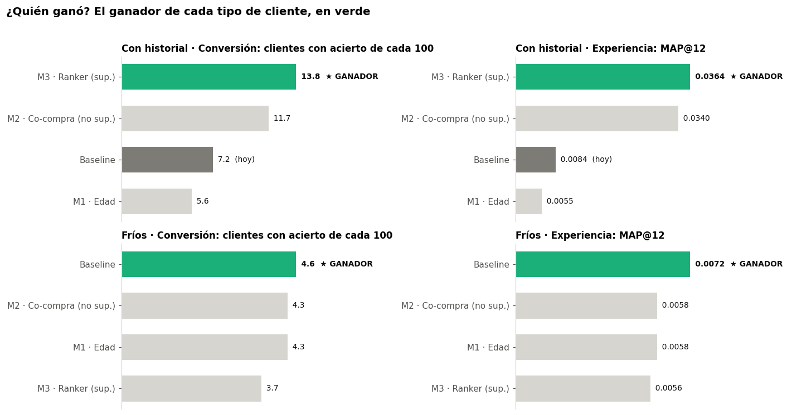

**Paso 6.3 · ¿Por qué ganó? (explicación automática con los números)**
**Qué hace:** para cada tipo de cliente explica por qué ganó el ganador:
1. **Cuántos KPIs ganó** de los 5.
2. **Cuánto mejora la conversión** frente a hoy, en clientes de cada 100.
3. **Si la ventaja es real o podría ser azar** (intervalo de confianza).
4. **Qué información aprovecha** que los demás no.

### 6.3 Notebook 05 · Simulación de clientes nuevos

Notebook: [`notebooks/05_simulacion_cold_start.ipynb`](../notebooks/05_simulacion_cold_start.ipynb).

**Lookwise Data Lab** · Sistema de recomendación para clientes nuevos de H&M (e-commerce)
**Autor:** Lookwise Data Lab · **Fase:** Evaluación complementaria
**Continúa:** `04_pipeline_modelos.ipynb` (modelos y modelo final)

**Pregunta de negocio**
Hoy a un cliente nuevo se le muestra **lo más vendido**. Apenas compra algo, ya sabemos qué le gusta. **¿A partir de cuántas compras un modelo personalizado le gana a lo más vendido?** Esa respuesta define **cuándo cambiar** de vitrina general a vitrina personalizada.

**Por qué simular:** en la semana de test hay solo **437 clientes nuevos reales**, y con ellos ningún modelo superó a lo más vendido de forma concluyente. Para responder con más evidencia, tomamos clientes que **sí** tienen historial y les **"borramos" el pasado**, dejando visibles solo 0, 1 o 2 compras. Así se comportan como clientes recién llegados, pero sabemos qué compraron después.

**Reglas de la simulación (fijadas antes de ver resultados)**

| # | Regla | Decisión | Por qué |
|---|---|---|---|
| 1 | **Quién entra** | Clientes que compran en la semana de test (16–22/09/2020) y que antes compraron **al menos 3 artículos distintos** | Así, aun con 2 compras visibles, siempre queda historial oculto. Es el **mismo grupo** en todos los escenarios: solo cambia cuánto se ve |
| 2 | **Cuántas compras quedan visibles** | **0, 1 y 2** (y el historial completo como referencia) | 0 = cliente recién llegado; 1 y 2 = sus primeras compras |
| 3 | **Cuáles quedan visibles** | Las **más recientes** (escenario principal); las **primeras** de su vida como control | Un cliente nuevo real acaba de llegar: sus primeras compras son de los últimos días, no de hace dos años |
| 4 | **Regla contra la fuga de información** | Las compras ocultas se **borran de toda la base**: no cuentan para la popularidad, los pares de co-compra ni el entrenamiento del ranker. Solo se usan compras anteriores al 16/09 | Si quedaran en algún lado, el modelo "recordaría" lo que se supone que no sabe |
| 5 | **Qué se evalúa** | Lo que esos clientes compran en la **misma semana de test** (16–22/09/2020) | Comparable con los resultados del notebook 04 |
| 6 | **Métricas** | **MAP@12** (principal) y **Hit Rate@12**, con **intervalo de confianza del 95%** (bootstrap pareado) | Las mismas del proyecto; el intervalo dice si la diferencia es real o azar |
| 7 | **Criterio de éxito** | Un modelo **le gana a lo más vendido** con N compras si mejora MAP@12 **y** Hit Rate@12 **y** el intervalo de la mejora en MAP@12 **no incluye el 0**. El **umbral** es el menor N desde el cual eso se cumple | Mismo criterio que las hipótesis del notebook 04 |
| 8 | **Cómo se reporta** | **Simulados y reales por separado** | Los simulados son una aproximación; los reales son la evidencia directa |
| 9 | **Modelos que entran** | Baseline (lo más vendido 7 días), Modelo 1 (edad), Modelo 2 (co-compra) y Modelo 3 (ranker con regresión logística) | Los mismos parámetros elegidos en validación en el notebook 04 |

> Los resultados y la **interpretación automática** aparecen al ejecutar **Run All**. Tarda unos **20–30 minutos**: el ranker se vuelve a entrenar en cada escenario, porque la base cambia.

#### Paso 2.2 · Gráfico: cuánto acierta cada modelo según las compras que conoce

**Qué muestra:** una línea por modelo. La línea **gris punteada** es lo más vendido: todo lo que queda **por encima** es mejor que lo que se hace hoy.

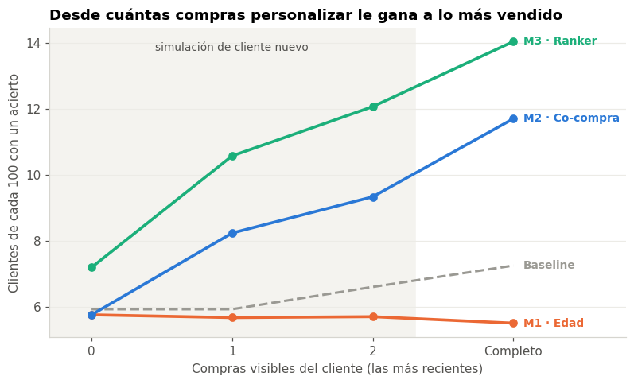

**Paso 2.3 · ¿La mejora es real o puede ser azar?**
**Qué muestra:** para cada modelo personalizado, cuánto mejora el **MAP@12** frente a lo más vendido (punto) y su **intervalo del 95%** (línea). Si la línea queda **toda por encima del 0**, la mejora es real.

### 6.4 Notebook 06 · Métricas, optimización, selección y evaluación final

Notebook: [`notebooks/06_metricas_optimizacion_decisiones.ipynb`](../notebooks/06_metricas_optimizacion_decisiones.ipynb).

**Autor:** Lookwise Data Lab
**Proyecto:** Sistema de recomendación para el e-commerce de H&M
**Notebook 06** · Continúa `03_baseline.ipynb`, `04_pipeline_modelos.ipynb` y `05_simulacion_cold_start.ipynb`

**Objetivo**

Seleccionar, con evidencia, el modelo que H&M debería usar para recomendar 12 prendas a cada cliente. Para eso, el notebook:

1. Define las métricas de evaluación y justifica cuál decide.
2. Optimiza el baseline antes de compararlo, para que la comparación sea exigente.
3. Entrena y compara modelos supervisados (regresión logística y Gradient Boosting) y uno no supervisado (co-compra).
4. Optimiza hiperparámetros y prueba si la mejora del modelo más complejo es significativa.
5. Evalúa el modelo elegido una sola vez en un período nunca visto.
6. Explica qué variables usa el modelo, muestra ejemplos de recomendaciones y documenta limitaciones.

**Modelos evaluados**

| Tipo | Modelo | Cómo aprende | Rol en el sistema |
|---|---|---|---|
| Referencia sin aprendizaje | Popularidad (lo más vendido, con ventana o decaimiento temporal) | Regla: cuenta ventas recientes | Vara a superar y recomendación para clientes nuevos |
| No supervisado | Co-compra + recompra (filtrado colaborativo ítem-ítem) | Pares de prendas compradas juntas, sin etiquetas | Modelo independiente y fuente de candidatas y variables del ranker |
| Supervisado | Ranker con regresión logística | Etiqueta compra / no compra de cada par cliente–prenda | Modelo base supervisado |
| Supervisado | Ranker con Gradient Boosting | Etiqueta compra / no compra de cada par cliente–prenda | **Modelo seleccionado** para clientes con historial |

**Estructura**

| Sección | Contenido |
|---|---|
| 1 | Datos y protocolo de validación |
| 2 | Métricas de evaluación |
| 3 | Referencia sin aprendizaje: baseline optimizado |
| 4 | Modelo supervisado: ranker con regresión logística |
| 5 | Modelo supervisado: optimización de hiperparámetros |
| 6 | Modelo supervisado: selección entre regresión logística y Gradient Boosting |
| 7 | Modelo no supervisado: co-compra + recompra |
| 8 | Evaluación final en test |
| 9 | Importancia de las variables |
| 10 | Ejemplos de recomendaciones |
| 11 | Justificación del modelo elegido y alternativas descartadas |
| 12 | Limitaciones, conclusiones y próximos pasos |
| 13 | Persistencia del modelo y exportación de resultados |

**Reproducibilidad:** todas las semillas están fijas (`random_state=42`). La ejecución completa (Restart → Run All) tarda entre 15 y 20 minutos con la muestra p10.

#### 3. Referencia sin aprendizaje · Baseline optimizado (popularidad)

**Método:** se comparan 9 variantes de "lo más vendido": ventanas de 1, 3, 7, 14 y 30 días, todo el historial y popularidad con decaimiento temporal (todas las ventas de 60 días, donde una venta pierde la mitad de su peso cada 3, 7 o 14 días). Cada variante se evalúa en **4 semanas consecutivas** (19/08 al 15/09/2020) y se elige la de mayor Recall@12 promedio.

**Por qué optimizar el baseline:** un baseline débil exagera la mejora de cualquier modelo. Compararse contra la mejor versión de la regla simple es una prueba más exigente.

**Por qué 4 semanas:** en moda, la demanda cambia de una semana a otra. Elegir con una sola semana puede premiar una variante que acertó por circunstancias puntuales.

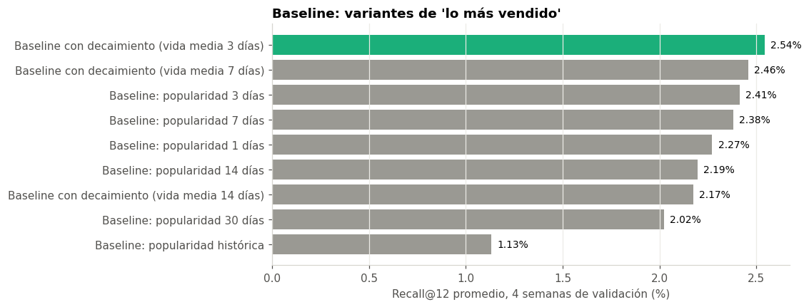

**Interpretación**

- **La recencia es la señal dominante.** Las variantes que priorizan las ventas recientes (decaimiento de 3 y 7 días, ventanas de 3 y 7 días) ocupan los primeros puestos; la popularidad de todo el historial queda última, con menos de la mitad del Recall@12. En moda, lo que se vendió hace meses predice poco lo que se comprará la semana siguiente.
- **Las diferencias entre las mejores variantes son pequeñas** (décimas de punto). Ajustar la regla de popularidad mejora poco: el margen de mejora real está en personalizar.
- **Decisión:** el baseline seleccionado es la referencia que deben superar los modelos y la recomendación para clientes sin historial.

#### 4.1 Por qué la Accuracy no alcanza

Se compara la regresión logística con un clasificador trivial que predice siempre "no compra", y con la misma regresión usando el umbral que maximiza F1 en validación.

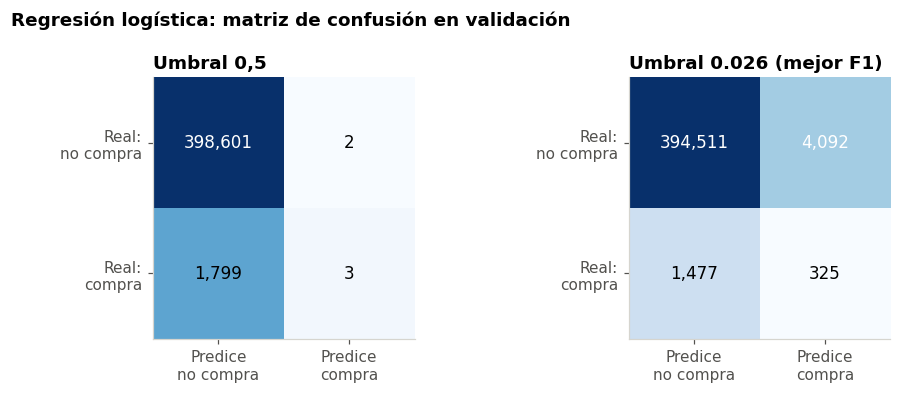

**Interpretación**

- **Desbalance extremo:** solo alrededor del 0,5% de los pares cliente–prenda terminan en compra. Por eso el clasificador trivial alcanza una Accuracy del 99,5% con Recall 0%: no detecta ninguna compra.
- **El umbral de 0,5 no sirve en este problema.** La regresión logística con ese umbral casi nunca predice compra (Recall de 0,2%) y su Accuracy es prácticamente igual a la del modelo trivial.
- **Con el umbral ajustado** (el que maximiza F1), el modelo detecta alrededor del 18% de las compras con una Precision cercana al 7%, unas 16 veces la tasa base de compra. ROC-AUC de 0,72: el modelo ordena las compras por encima de las no compras bastante mejor que el azar (0,5).
- **Implicancia para el recomendador:** no hace falta un umbral. Se ordena por probabilidad y se muestran las 12 primeras, por lo que la métrica que decide es Recall@12. Las métricas de clasificación se reportan como diagnóstico.
- **Límite estructural:** las candidatas contienen cerca del 12% de lo que los clientes compran. Ningún clasificador puede recomendar prendas que no estén entre las candidatas; mejorar la generación de candidatas es la palanca con más potencial.

#### 5. Modelo supervisado · Optimización de hiperparámetros (regresión logística y Gradient Boosting)

**Método:** búsqueda en grilla de 16 configuraciones, entrenadas y evaluadas con los mismos datos:

| Algoritmo | Hiperparámetros explorados |
|---|---|
| Regresión logística | Regularización `C` ∈ {0,01; 0,1; 1; 10} × `class_weight` ∈ {ninguno, balanceado} |
| Gradient Boosting (HistGradientBoosting) | (tasa de aprendizaje, hojas por árbol, iteraciones) ∈ {(0,05; 15; 200), (0,1; 31; 200), (0,05; 31; 400), (0,1; 63; 300)} × `class_weight`; regularización L2 = 1 |

**Por qué estos hiperparámetros:** `C` y la regularización L2 controlan el sobreajuste; la tasa de aprendizaje, el tamaño de los árboles y las iteraciones controlan la capacidad del Gradient Boosting; `class_weight="balanced"` compensa el desbalance de clases.

**Criterio:** mayor Recall@12 en validación; desempate por MAP@12. Se eligió una grilla acotada en lugar de una búsqueda exhaustiva porque cada configuración requiere reconstruir el ranking de 4.000 clientes, y el objetivo del sprint es la metodología más que el máximo desempeño.

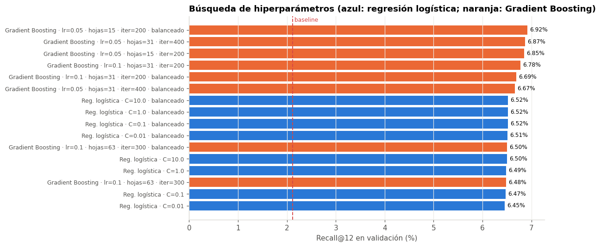

**Interpretación**

- **Todas las configuraciones superan ampliamente al baseline** (alrededor de 6,5% frente a 2,1% de Recall@12 en validación). La mayor parte de la ganancia proviene de personalizar, no del ajuste fino.
- **En la regresión logística, `C` prácticamente no cambia el resultado** (6,45% a 6,52%): con 17 variables y 400.000 pares, el modelo no está sobreajustando y la regularización tiene poco efecto.
- **`class_weight="balanced"` cambia mucho las métricas de clasificación y poco el Recall@12.** El Recall del clasificador con umbral 0,5 pasa de casi 0% a más del 50%, porque las probabilidades se desplazan hacia arriba; pero el orden de las candidatas casi no cambia, y el ranking es lo que determina las 12 recomendaciones. Esto confirma que las métricas de clasificación a umbral fijo no deben guiar la elección en un recomendador.
- **Gradient Boosting obtiene el mejor Recall@12** con la configuración más regularizada (árboles pequeños, tasa de aprendizaje baja) y clases balanceadas. Las configuraciones más grandes (63 hojas) rinden menos, lo que sugiere sobreajuste.

#### 8. Evaluación final en test

**Método:** con todas las decisiones tomadas en validación, se reentrena hasta el 15/09/2020 y se mide una única vez en la semana del 16/09 al 22/09/2020, por segmento de cliente.

El **modelo final es un sistema por etapas**: el ranker seleccionado para los clientes con historial y el baseline seleccionado para los clientes sin compras previas, que no tienen información para personalizar (ver notebook 05).

Se incluye también la popularidad de 7 días como referencia de lo que la tienda puede hacer hoy sin modelos.

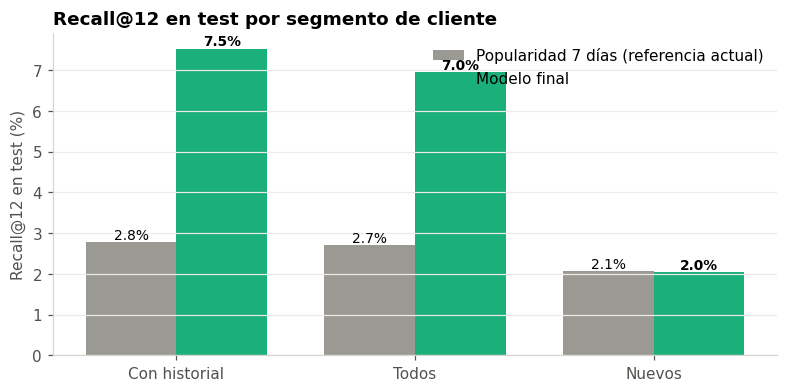

**Interpretación**

- **Clientes con historial (3.725, el 90% de los compradores de la semana):** el modelo final eleva el Recall@12 de 2,78% a 7,53%, unas 2,7 veces la referencia actual. La mejora es de +4,75 puntos, con un intervalo de confianza del 95% entre +3,89 y +5,48: no es atribuible al azar. El Hit Rate@12 pasa de 7,25% a 14,79%, es decir, el doble de clientes encuentra en su vitrina al menos una prenda que termina comprando.
- **Clientes nuevos (437):** el sistema les muestra el baseline y el resultado es equivalente a la referencia (2,04% frente a 2,07%, sin diferencia significativa). Sin historial no hay señal para personalizar; la mejora para este segmento requiere datos adicionales (ver próximos pasos).
- **Cobertura de catálogo:** la popularidad muestra las mismas 12 prendas a todos los clientes; el ranker recomienda 4.123 prendas distintas. Además de acertar más, da visibilidad a una parte mucho mayor del catálogo.
- **Consistencia con validación:** el orden de los modelos en test (ranker > co-compra > popularidad) es el mismo que en validación, lo que indica que la selección no se sobreajustó a la semana de validación.
- **Métricas de clasificación en test:** con el umbral calibrado en validación, la Accuracy (98,8%) queda por debajo de la del clasificador trivial (99,5%), pero el modelo detecta el 15,3% de las compras con una Precision del 8,3%, unas 17 veces la tasa base de compra (0,49%). ROC-AUC de 0,74.

#### 9. Importancia de las variables

**Método:** importancia por permutación sobre el modelo seleccionado, en la semana de validación. Se desordena una variable por vez y se mide cuánto cae el PR-AUC: cuanto mayor la caída, más depende el modelo de esa variable. Para acotar el tiempo de cómputo se usan todas las compras y una muestra aleatoria de 50.000 pares sin compra.

**Por qué por permutación:** se aplica igual a la regresión logística y al Gradient Boosting, y mide el efecto sobre el desempeño en datos no usados para entrenar.

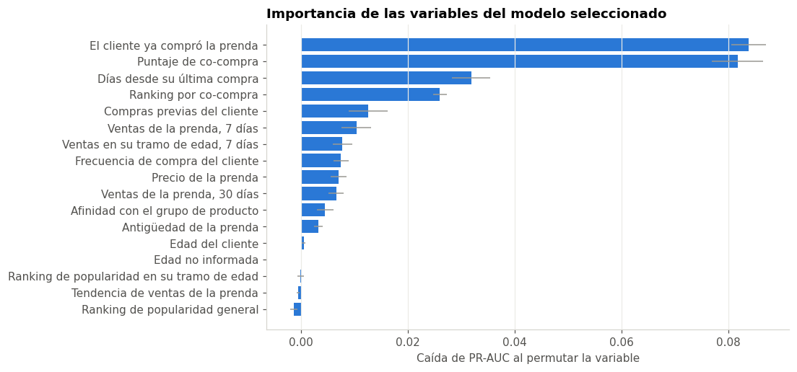

**Interpretación**

- **El comportamiento previo del cliente con la prenda es la señal más fuerte.** Que el cliente ya haya comprado la prenda (recompra) y el puntaje de co-compra son, por amplio margen, las dos variables más importantes: permutarlas reduce el PR-AUC en más de 0,08 cada una, más del doble que la tercera variable.
- **La recencia del cliente es la tercera señal:** quien compró hace pocos días tiene más probabilidad de volver a comprar en la semana.
- **La popularidad aporta poco una vez que se conoce al cliente.** Las ventas recientes de la prenda suman información, pero los rankings de popularidad general y por tramo de edad, la tendencia y la edad del cliente tienen importancia nula o levemente negativa. Esto es coherente con el notebook 03: la edad sola no supera a la popularidad y no agrega señal cuando hay historial.
- **Implicancia:** estas variables son candidatas a eliminarse en el próximo sprint para simplificar el modelo sin pérdida de desempeño. Para el negocio, la importancia de la recompra respalda acciones concretas como recordatorios de compra de otro color o talle.
